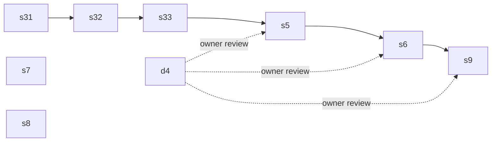

## Context

[docs/wp27-ffi.md](../../docs/wp27-ffi.md) §8 designs S3, string marshalling, and it is unbuilt. `declare function` takes scalars and `CPtr` alone today ([src/declarations.ts:152](../../src/declarations.ts) `checkForeignSignature`; `CPtr` is barred from fields, elements and type arguments by `rejectForeignPointer`, [src/annotations.ts:166](../../src/annotations.ts)). A foreign call is a plain `call` with no attributes ([src/emit.ts:879](../../src/emit.ts) `foreignDeclarationFor`). The callee's facts are `EFFECT_WRITE`, `willReturn=false` and `sharedWrite` ([src/attributes.ts:3386](../../src/attributes.ts)), so its callers keep only `nounwind`. FFI cases leave the differential oracle by a row in [tests/differential/known-failures.txt](../../tests/differential/known-failures.txt) (`:46-47`). No `std/` file declares a C function today.

std/ already has about 15 private endian helpers in 11 files: `sha256LoadWord`, `sha1LoadWord`, `p256LoadWord`, `aesLoad32`/`aesStore32`, `aesLoad64`, `tlsWordAt`, `tlsPutU16`, `http2FrameU32`, `chacha20Word`, `poly1305Le64`, among others. None is exported or documented. No 128-bit integer or `mulhi` exists anywhere. x25519 uses ten limbs in radix 2^25.5 with 64-bit products. Poly1305 uses five 26-bit limbs. P-256 is fiat-crypto with u32 limbs.

WP27 already names S4 (struct layout) and S5 (`errno`). The new byte-buffer and handle design therefore goes in a new doc, [docs/wp40-ffi-buffers-handles.md](../../docs/wp40-ffi-buffers-handles.md), so its stage names collide with nothing.

## Approach

- **Stages 1–3 are §8g's three steps, verbatim.** The design is accepted, and the worker builds it. Where §8 and the code disagree, the worker stops and says so in the PR; it does not redesign. The `ffi-nul` and `ffi-null` kinds, the literal proof, `nish_ffi_cstr` and `nish_ffi_str` keep the names §8 gives them.
- **Stage 4 is the owner's gate.** It merges, and then the run stops: stages 5, 6 and 9 do not start until the owner has reviewed the merged doc. Their todos are rendered from the doc as merged, not from this plan.
- **Stage 7 publishes existing code.** The module is new, the semantics come from the existing copies, and it migrates none of the copies, so it moves no crypto file.
- **Stage 8 measures before it ships.** The bar is committed first. A miss ships the record alone, as wp38 S3a did.
- **Stage 9 is conditional by construction.** Stage 4's doc answers whether a std/ foreign call can keep the builtin's attributes, capability, closed-build status and oracle coverage. The facts above say none of them survives today, so the expected outcome is the written finding. The owner's review of stage 4 decides.

## Shared files and merge order

Every stage that changes `src/` moves the generated goldens. Those are regenerated, never merged by hand (CLAUDE.md). Stages 1, 2, 3, 5 and 6 share the FFI lane (`src/declarations.ts`, `src/escape.ts`, `src/attributes.ts`, `src/panics.ts`, `runtime/runtime.c`, `docs/LANGUAGE.md` Calling C), so they develop **one after another**. Each starts once the previous one has merged.

Stage 8 overlaps the lane at the section level only: `src/builtins.ts`, `src/emit-builtins.ts`, `src/nish-modules.ts`, `runtime/nish.d.ts`, `src/codes.ts`, `docs/LANGUAGE.md`, `docs/IR_COOKBOOK.md` and `tests/run.js`. It edits different functions and sections there. It runs alongside stage 1, and a textual conflict goes back to whichever worker merges second. Stages 4 and 7 share no hand-written file with any other stage.



| stage | Owns | depends on (merge) |
| --- | --- | --- |
| s31-string-params | the FFI lane, below | — |
| s32-string-returns | the FFI lane | s31 |
| s33-readcstring | the FFI lane, plus `tests/cases/reject_unsafe_*` | s32 |
| d4-design | `docs/wp40-ffi-buffers-handles.md` | — |
| s5-u8-buffers | the FFI lane, plus `docs/wp40-ffi-buffers-handles.md` | s33, d4 + owner review |
| s6-owned-handle | the FFI lane, plus `docs/wp40-ffi-buffers-handles.md`, `docs/guide/language/memory.md`, `tests/cases/using_*`, `tests/cases/reject_using_*` | s5 + owner review |
| s7-endian | `std/bytes.ts`, `src/std-modules.ts`, `std/README.md`, `docs/guide/using-nish/standard-library.md`, `tests/cases/std_bytes_*` | — |
| s8-mul-wide | `src/builtins.ts`, `src/emit-builtins.ts`, `src/nish-modules.ts`, `src/capabilities.ts`, `src/codes.ts`, `runtime/nish.d.ts`, `std/crypto/chacha20poly1305.ts`, `bench/mul-wide*`, `docs/wp41-mul-wide.md`, `docs/LANGUAGE.md` (its builtin's section), `docs/IR_COOKBOOK.md` (its entry), `docs/cookbook/mul-wide*`, `tests/cases/mul_wide*`, `tests/run.js` (its checks) | — |
| s9-std-wrapper | per the approved design: `docs/wp40-ffi-buffers-handles.md` for a finding; one `std/` file, `runtime/runtime-os.c`, `src/runtime.ts`, `src/builtins.ts`, `src/emit-builtins.ts`, `runtime/nish.d.ts` for a move | s6 + owner review |

**The FFI lane** is these paths:

- compiler: `src/**` except `src/std-modules.ts` (stage 7's); the stages that use it develop one at a time, so a narrower list would only block a worker on a call site it did not predict
- declarations: `runtime/nish.d.ts`
- runtime: `runtime/runtime.c`, `runtime/nish.h`, `tests/runtime-test.c`
- tests: `tests/cases/ffi_*`, `tests/cases/panics_ffi_*`, `tests/cases/reject_ffi_*`, `tests/run.js`, `tests/differential/known-failures.txt`
- docs: `docs/LANGUAGE.md`, `docs/IR_COOKBOOK.md`, `docs/cookbook/decl-ffi*`, `docs/guide/using-nish/interop.md`, `docs/security/runtime.md`, `docs/wp27-ffi.md`

Generated files, regenerated and never hand-edited: `tests/self/goldens/**`, `tests/differential/goldens/**`, `tests/cases/*.ll`, the IR_COOKBOOK runtime-prelude block, and `CHANGELOG.md`.

A worker that finds it must edit a file outside its Owns stops and says so in the PR. It does not widen its lane.

## S3.1, Checker

`string` and `string | null` are accepted in parameter position in `checkForeignSignature`. `string[]` stays refused, as `reject_ffi_string_array_param`. The `reject_ffi_string_param` case is retired, and its LANGUAGE.md refusal becomes the rule.

## S3.1, The borrow

This is §8b's rule. `src/escape.ts` treats a string passed to a `declare function` as a read, as it does for `console.log`'s argument. The foreign callee's escaping facts in `src/attributes.ts` stay empty. No LLVM attribute goes on the parameter: no `nocapture` and no `readonly` (§8b, "Attributes").

## S3.1, Lowering

The argument lowers to `s->data`, the address 8 bytes into the `nish_str`. A literal the checker knows has no NUL is passed directly, with no check and no panic site. Any other string goes through `nish_ffi_cstr(const nish_str *s, <callee name, argument index>)`. That function answers `s->data`, or panics with §8c's message when `strlen(s->data) != s->len`. A `string | null` argument passes `NULL` for `null`.

## S3.1, Runtime

`nish_ffi_cstr` lives in `runtime/runtime.c` (with its prototype in `nish.h`) and stays inside `RUNTIME_TEXT_BUDGET` ([tests/runtime-budgets.js:51](../../tests/runtime-budgets.js)). A ceiling raised to fit it is a blocking finding, not a fix. The declaration in `src/runtime.ts` moves the cookbook prelude, so `bash docs/cookbook/regen.sh` runs in the same commit. `ffi-nul` becomes a row in `src/panics.ts` (not in `isAllowed`), in `--emit-panics` and in LANGUAGE.md's panic table, and `--deny-panics` refuses it.

## S3.1, Tests

These follow §8g's row:

- `ffi_string_param`: a golden `.ll` and a native round trip against libc (`strlen`, `puts`, `atoi`, `setenv`, then the runtime's `getenv`).
- `ffi_string_param_arena`: a concatenated string passed from a function whose arena scope releases after the call. It links a `.c` sidecar that copies what it read.
- `panics_ffi_nul`: the panic, natively.
- `reject_ffi_string_array_param`.

The panic and the literal proof also get `tests/run.js` checks: `puts("hello")` has no `nish_ffi_cstr` call, and `--emit-panics` lists `ffi-nul` for a non-literal argument.

The two `--deny ffi` siblings are new negative checks:

- a program whose only foreign call takes a string is refused;
- the string is passed from a constructor reached by `new`, which is the CLAUDE.md sibling.

The new positive cases go into `known-failures.txt` beside `ffi_scalar`, and then `node tests/differential/goldens.js --update` registers them.

## S3.1, Docs

- **LANGUAGE.md "Calling C".** The borrow rule is in its first sentence, with `putenv` named and the `strdup` example from §8b. The `const char *` no-write rule sits beside it. The panic gets a row.
- **IR_COOKBOOK.** An entry next to `decl-ffi` with a `docs/cookbook/decl-ffi-string.ts` program.
- **The guide.** A section in [docs/guide/using-nish/interop.md](../../docs/guide/using-nish/interop.md).
- **wp27-ffi.md.** S3.1 becomes built, in §3's table and §8's status line.

## S3.1, Security record

The next `RT-n` row of [docs/security/runtime.md](../../docs/security/runtime.md) records the borrow contract, which the compiler states and cannot check (§8i), and the NUL rule. It is anchored at a stated commit. Its Tests list names every check by its exact `check(...)` string, grepped against `tests/run.js` before push.

## S3.2

This is §8d.

- **Returns.** `string` and `string | null` returns copy into the arena with `nish_ffi_str(const char *p, <callee name>)`. A `NULL` is `null` for `string | null`. For `string` it is the `ffi-null` panic, with §8d's message.
- **No free.** The copy is never freed, and the doc says to declare an allocating C function as returning `CPtr | null`.
- **Tests.** `ffi_string_return`, `panics_ffi_null`, and `reject_ffi_string_return` retired.
- **The security row.** S3.1's RT row gains the copy-out direction, or a new row records it.

## S3.2, Measurement

The loop calls `strerror(i % 134)` over 10^7 iterations and folds each answer's length and first byte into a printed checksum. It is timed against a byte-identical copy of the same binary in interleaved rounds (at least 15), and the min and median both go in the `Measured:` trailer with the noise band. The figure states the copy's cost per call, with no claim of "fast".

## S3.3

This is §8e and §8f.

- **`readCString`.** `readCString(p: CPtr): string` is the sixth export of `nish:unsafe`. It is a runtime copy, the one `CPtr` dereference, and it is done in C. It is an `unchecked` site with `"allowed": true` in `--emit-checked`.
- **The null parameter.** A `CPtr | null` parameter becomes legal, and at a call it accepts the literal `null` only. A `CPtr | null` variable passed there is refused until it is narrowed (`reject_ffi_pointer_nullable_variable`). `reject_ffi_pointer_nullable_param` is retired or narrowed to what is still refused.
- **Tests.** `ffi_owned_string` round-trips `strdup` → `readCString` → `free` and `realpath(".", null)` → `readCString` → `free`. Its expected stdout must not depend on the checkout path: print a property of the answer, not the path itself. `reject_unsafe_no_import` is extended to `readCString`.
- **wp27-ffi.md.** §3's table and §8's status say S3 is built.

## Design doc

This is [docs/wp40-ffi-buffers-handles.md](../../docs/wp40-ffi-buffers-handles.md), written in the house style of wp27 §8: decision first, then the alternatives weighed, then steps and tests. It is built from `src/` as it stands, with `file:line` anchors at a stated commit.

### Buffers

`u8[]` crosses as pointer plus length: `const uint8_t *` read-only, or `uint8_t *` writable. The doc settles four questions:

- how the length crosses: as one C argument expanded from the array, or as a separate declared parameter checked at the call;
- how read-only and writable are spelled: `readonly u8[]` against `u8[]`, or another spelling;
- what a write through a borrowed buffer does to bounds facts and to the array's other aliases;
- whether a C `read` that returns a count larger than the length is clamped or panics.

It is the same borrow as S3, so no address may be kept. The motivating declarations are `read(fd: i32, buf: u8[], n: u64): i64` and `write`, and the doc must make them callable with no shim.

### Handles

This is a class field holding a foreign handle, the one widening of §7a's "no field". The handle is released at a known point by a `using` block, and `using` today admits only `scope()`, `Mutex.lock()` and `arena()` ([src/parallel.ts:1208](../../src/parallel.ts)). The doc settles three questions:

- how the class names its close function: a declared foreign function, with no Nish function pointer;
- whether use after close and double close are refused statically or are a defined panic (a new kind);
- what happens when the owning object escapes its `using` scope, is copied, is stored in an array, or is captured.

### Interactions

For buffers and for handles, separately, the doc gives one paragraph each on:

- `src/escape.ts` and the arena scopes;
- `nish_arena_keep`;
- `--deny ffi` and the capability report;
- `--emit-header`, `--emit-dts` and `--emit-napi` (whether a class owning a handle may be exported, and what each generator does if not);
- wasm32, and the freestanding `--profile wasm` route, which links host-compiled IR ([scripts/build.sh:367](../../scripts/build.sh));
- the differential oracle.

### Siblings

The doc has a table of every way a value reaches the new rule, each with a planned negative case name:

- a constructor reached by `new`;
- every declarator of `using a = …, b = …`;
- `this` leaving a constructor (`h.l = this`);
- a closure capture;
- a generic type argument;
- an array element;
- a `Result` arm;
- a return from a program function;
- an `async` function;
- a `scope()` task;
- an inherited field;
- any other entry the author finds.

### Stage 9 precondition

The doc answers one question with evidence: can a `std/` function that calls a `declare function` keep everything the builtin it replaces has today? That covers:

- its `plain()` attributes ([src/runtime.ts:153](../../src/runtime.ts));
- its capability, `fs` rather than `ffi`;
- its closed-build status ([src/visibility.ts:99](../../src/visibility.ts));
- its oracle coverage, given that `shim.mjs` cannot run a C call.

If that needs a trusted-std mechanism (for example a summary only `std/` may declare), the doc says what the mechanism costs and whether it is worth building, and the owner decides. The doc's answer is either "stage 9 moves `<wrapper>`" or "stage 9 is this finding".

## Build stages 5 and 6

These are rendered from the merged doc after the owner's review. Each ships the full definition of done, as stages 1–3 do. Stage 5's acceptance programs are `read` and `write` on a `u8[]`. Stage 6's acceptance programs are an `fopen` handle owned by a class, closed by `using`, with a negative case for use after close and one per sibling in the doc's table.

## Endian module

- **The module.** `std/bytes.ts`, imported as `nish/bytes`. It exports these, where `T` is `u16`, `u32`, `u64`, `i32`, `i64`, `f32` or `f64`, and `f32`/`f64` only if the bit cast is already expressible:
  - `getU16LE(b: u8[], off: i32): u16` through `getT_LE` and `getT_BE`;
  - `setU16LE(b, off, v)` and the `set` forms for every `T`.
- **Semantics.** Each is checked by `a[i]`'s rule, so an out-of-range offset panics `index`. There is no wrapping and no clamping. The semantics match std's existing copies byte for byte, and the PR names the copies it was checked against.
- **Provable.** A caller that guards `off + 3 < b.length` before calling should get no residual bounds check after inlining. The PR shows the optimised IR for one guarded loop. If the proof does not reach through the call, the PR says so with the IR and does not add a new proof rule, which would be another stage.
- **Tests.** Every width and both orders, natively and under Node (the module is pure Nish, so the oracle covers it), plus a negative out-of-range run. `node tests/differential/goldens.js --update` runs in the same commit. `node tests/run.js performance` must show no new warning from `std/bytes.ts`.
- **Docs.** A section in `docs/guide/using-nish/standard-library.md` and a row in `std/README.md`. Migrating the private copies is out of scope.

## Wide multiply

### The bar

Committed in `docs/wp41-mul-wide.md` before any kernel is timed:

> Poly1305 over a 64 KiB message, 2^12 MACs, each over a message one byte different from the last, folded into a printed checksum. The radix-2^26 kernel on `main` against a wide-limb kernel (radix 2^44 or 2^64) on `mulHigh`/`mulLow`, plus a byte-identical copy of `main`'s for the noise band, in at least 15 interleaved rounds. **Met** if the new kernel's min and median are both faster than `main`'s by more than the noise band, natively on x86-64. A win on wasm32 is reported, not required. A loss there outside the band is a miss.

### The builtin

There is no new global. `mulHigh(a: u64, b: u64): u64` gives the high 64 bits of the 128-bit product, and `mulLow(a: u64, b: u64): u64` the low 64 bits. They are exported from a `nish:` module, and the worker picks the name in the PR body. Neither panics.

- **Native lowering.** `zext` both operands to `i128`, `mul i128`, and `lshr` and `trunc`.
- **wasm32 and `--profile wasm`.** A 32-bit-halves sequence with no `__multi3` libcall, because the freestanding route links `-nostdlib`. It is constant-time on every target. The `ct` checks pin the native lowering, and an IR check pins the absence of `__multi3` under the wasm profile.

### The kernel

Only `std/crypto/chacha20poly1305.ts`'s Poly1305 changes. It keeps its `Secret` and `wipe` discipline (CLAUDE.md, Security). The RFC 8439 vectors and the existing tests pass unchanged.

### The decision

- **Bar met.** The PR ships the builtin, the kernel, its tests, LANGUAGE.md, IR_COOKBOOK and guide entries, and the record with the figures in the `Measured:` trailer.
- **Bar missed.** The branch drops the builtin and the kernel and ships only `docs/wp41-mul-wide.md` with the figures, as `docs(perf): …`.

## Stage 9

Do what the approved design doc says. If it is a move, these must hold:

- the wrapper's callers keep their attributes, checked by diffing `--emit-checked` for a program that uses it;
- no case becomes a known differential failure;
- `--deny ffi` does not start refusing programs that used the builtin;
- `RUNTIME_OS_TEXT_BUDGET` goes down;
- no benchmark that calls the wrapper slows outside its noise band.

If any of these fails, the stage ships the finding instead.

## Out of scope

Each of these is refused by name in LANGUAGE.md and the design doc, and is not merely left out:

- raw pointers, pointer arithmetic and dereference (beyond `readCString`'s copy in C);
- `CPtr` in arrays or in generic type arguments;
- inline assembly;
- direct syscalls that bypass libc;
- user-defined allocators;
- function pointers and C callbacks;
- variadic C functions;
- a SIMD type, which wp38 owns;
- `string[]` across the boundary;
- C struct layout (WP27 S4) and `errno` (WP27 S5).

**The rolling freeze.** No stage changes `src/`'s own source to *use* any of these features. `src/` may use them only from the release after they land, and `std/` from the commit that lands them. Every stage ships with no 1.0.0 and no `Release-As:` trailer, and the Release PR is never merged.

## Tests

Each language stage ships:

- a golden `.ll` and an `llvm-as` pass;
- a native round trip with expected stdout;
- at least one negative case;
- its LANGUAGE.md rule;
- its IR_COOKBOOK entry and `docs/cookbook/` program;
- its guide section.

The cases mirror `tests/cases/ffi_pointer.ts` and `tests/cases/reject_ffi_pointer_param.ts`. Sidecars are named `<case>.c` ([tests/run.js:967](../../tests/run.js)).

## Verification

Before every push of a stage that changes `src/` or `std/`:

```bash
bash scripts/fetch-seed.sh --force
npm run check
npm run lint
node tests/run.js <the stage's filter>
node tests/run.js wasi        # read its skip line; WASI_SYSROOT=/usr if wasi-libc is installed
node tests/run.js performance
node tests/self/goldens.js --update   # read the diff
node tests/differential/goldens.js --update   # when a positive case is added
```

The full `npm test` runs twice per PR: before the PR opens and after `main` is merged when the lead says the PR is next. The worker reads the summary's skip count and `DEGRADED:` line against `main`'s.
