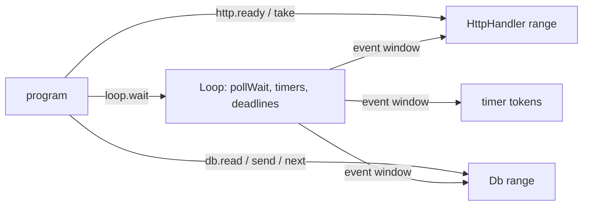

# A friendly event loop, Postgres on it, and serve()

## Context

A Nish server today talks to Postgres by writing the readiness loop by hand. [`tests/postgres/carrier.ts`](../../tests/postgres/carrier.ts) runs one query beside an HTTP listener in 255 lines, about 150 of them sockets, tokens, connect states, partial flushes and epoll re-arming. The challenge server built on the same shape is 2,900 lines in its worker alone.

Three gaps cause this:

- **No shared loop.** [`HttpHandler`](../../std/net/handler.ts) owns its own `pollWait`, and its `watch(fd, id)` watches only for reading, so a `PgPool` socket, which needs write interest, cannot live beside it. A program that wants both drops to `Http1Server`.
- **`PgPool` is sans-IO and nothing carries it.** [`std/net/postgres.ts`](../../std/net/postgres.ts) says which slot wants a socket and when, and leaves every byte to the program. Parameters can only be bound after `dispatch()` picks a connection.
- **Prefork is boilerplate.** [`std/net/prefork.ts`](../../std/net/prefork.ts) works; each program repeats the argv dance and the per-worker listener.

The language rules this has to respect: no function values and no methods on interfaces ([`docs/LANGUAGE.md`](../../docs/LANGUAGE.md#function-parameters)), so a driver cannot be registered as a callback; a thread task may not do I/O (the checker refuses `nish_net_read` in a `spawn`), so multi-core stays processes.

## Approach

**Pull with a shared event window.** The `Loop` makes the one `pollWait` call and keeps its results. Each driver owns a token range from `loop.reserve(n)` and reads its own events out of the window when the program calls it (`http.ready()`, `db.next()`). Nothing calls into the program, and nothing needs dispatch: a driver filters the window by its range, which is at most 512 pairs a turn.



**Drivers flush eagerly.** `db.send` and `http.send` write at once and arm write interest only on `-11`, so the loop needs no "before wait" hook. A driver with a deadline tells the loop (`loop.deadline(at)`), and `wait` folds the nearest one into its timeout.

**Each layer stays usable alone.** `PgPool`, `PgConnection`, `Http1Server` and the old `HttpHandler` constructor are unchanged; the new types are built on them, so the zero-copy path stays open to a program that wants it.

## Design note and examples

Before code, publish an examples report (an artifact) showing the same programs written against the proposed API, and iterate on it with the user: a timer-only loop, the loop over a raw socket, `HttpHandler` alone on a loop, `Db` alone, the two together, `serve`, and what each would read like under `async`. Its agreed shape becomes [`docs/wp49-friendly-io.md`](../../docs/wp49-friendly-io.md).

## Decisions

| Decision | Proposal | Alternative |
| --- | --- | --- |
| Where a driver's events go | it reads its token range out of the loop's window | the loop holds a concrete field per std driver type and pushes |
| When parameters are bound | at `db.read(...)`, copied into the ticket's buffer | at dispatch, as `PgPool` does (zero copy, harder) |
| How a result finds its request | an `i32` tag the caller chooses; `HttpHandler` gives `req.id`, and `http.request(id)` answers null for a stale one | `Db<T>` generic over a tag type |
| Rows | streamed, `DB_ROW` per row, columns read in place | a buffered `db.rows()` helper, later |
| A lost connection | `DB_LOST`; a write is never sent again, a read again only with `retryReads` | retry nothing |
| Queue full | `db.send` answers false; the guide shows a 503 | block |
| The module name | `nish/net/loop` (it is network surface, so it has a security record) | `nish/loop` |

## Stage 1 Loop

[`std/net/loop.ts`](../../std/net/loop.ts), new.

```ts
export class Loop {
  constructor(maxEvents: i32)                       // pollCreate; panics when it fails
  reserve(count: i32): i32                          // a token range for a driver: its base
  watch(fd: i32, token: i32, events: i32): boolean  // LOOP_READ | LOOP_WRITE
  rearm(fd: i32, token: i32, events: i32): boolean  // only a changed interest reaches epoll_ctl
  unwatch(fd: i32): void
  after(ms: i32): i32                               // a one-shot timer: its token
  every(ms: i32): i32
  cancel(timer: i32): void
  deadline(atNanos: i64): void                      // the next wait wakes by then
  wait(maxMs: i32): i32                             // one pollWait; events in the window
  now: i64                                          // monotonic nanos at the wait's end
  count(): i32                                      // events in the window
  token(k: i32): i32
  events(k: i32): i32                               // LOOP_READ | LOOP_WRITE | LOOP_HANGUP
  fired(timer: i32): boolean
  turn: i32                                         // bumped by every wait, so a driver reads a window once
}
```

Timers are a binary heap of (deadline, token) in two arrays, no allocation per timer once warm; a timer token is negative and below every reserved range. `wait` waits until the earliest of the earliest timer, the earliest deadline and `maxMs`, in milliseconds rounded up, capped as `HTTP_CLIENT_MAX_WAIT_MS` is, and an `EINTR` answers 0 events as `pollWait` does.

Docs: [`docs/security/loop.md`](../../docs/security/loop.md) (scope, threat model, timer and token arithmetic findings), its row in [`docs/security/README.md`](../../docs/security/README.md), a row in [`std/README.md`](../../std/README.md), and [`docs/guide/using-nish/event-loop.md`](../../docs/guide/using-nish/event-loop.md) routed in [`scalar.config.json`](../../scalar.config.json).

## Stage 2 HttpHandler

In [`std/net/handler.ts`](../../std/net/handler.ts):

- `httpHandlerOn(loop, limits, listener, router)` builds a handler that reserves its tokens on `loop` and never calls `pollWait` itself; the program calls `loop.wait`, then `http.ready()`, which reads the handler's events from the window the first time it is called in a turn.
- The existing constructor makes a private `Loop`, and `h.wait(ms)` becomes that loop's `wait` plus the same read, so every current program and test is unchanged.
- `req.id` packs the request's pool index and a generation; `http.request(id)` answers the request, or null once it was answered or its connection closed. This is the tag a `Db` result carries back.

Docs: [`docs/security/handler.md`](../../docs/security/handler.md) gains the shared-loop path and the stale-id check; [`docs/guide/using-nish/api-server.md`](../../docs/guide/using-nish/api-server.md) gains a "Beside other drivers" section.

## Stage 3 Db

[`std/net/db.ts`](../../std/net/db.ts), new, over `PgPool`:

```ts
const db = new Db(loop, "postgres://app@127.0.0.1:5432/app", password, new DbOptions());
db.prepare(ARTICLE, "select slug, title from articles where slug = $1", [PG_TEXT]);

const q: DbQuery = db.read(ARTICLE, req.id);  // or db.write(...)
q.text(slug);
if (!db.send(q)) { /* queue full */ }

while (db.next()) {
  switch (db.event) {
    case DB_ROW:   /* db.text(0), db.int(1), db.colStart(c), ... in place */ break;
    case DB_DONE:  /* db.tag, db.rows */ break;
    case DB_ERROR: /* db.error.code, db.error.message */ break;
    case DB_LOST:  /* the connection went with this query */ break;
  }
}
```

- **Connect.** The URL is parsed into a `PgConfig` (user, host, port, database, `sslmode` refused for now); a name is looked up with `DnsClient` on the same `Loop`, a literal directly. Each `PgPool` slot gets a socket when `wanted()` names it, watched under the Db's range; connect, `connectResult`, flush and read are the carrier's, written once.
- **Tickets.** A `DbQuery` holds the statement, the tag and its parameters in a byte buffer; at dispatch the Db replays them into `bindStart` ... `bindEnd` on the chosen connection. Read and write go to two `PgPool`s sized by `DbOptions.reads` and `writes`; `pipeline` is `maxInFlight`.
- **Groups.** `db.group(tag)` ... `db.end()` sends several statements under one `sync()`, one implicit transaction; its events carry one tag and one `DB_DONE`.
- **Secrets.** The password is a `Secret<u8[]>`, handed to `PgPool` as today; `db.dispose()` wipes it, and the record says so.

Docs: [`docs/security/db.md`](../../docs/security/db.md) (URL parsing, the parameter buffer bounds, the lost-write rule), its index row, and a section of [`docs/guide/using-nish/postgres.md`](../../docs/guide/using-nish/postgres.md).

## Stage 4 serve

[`std/net/serve.ts`](../../std/net/serve.ts), new: `serve(args, config, (worker: i32): i32 => ...)` takes `process.argv`, starts `config.workers` (default `availableParallelism()`) through `preforkWith`, and in each worker runs the arrow, which builds its own `Loop`, `HttpHandler` (on a `tcpListenFlags` listener with `SO_REUSEPORT` and `TCP_NODELAY`) and `Db`. The arrow is a function parameter, so it is a direct call. The supervisor's answer is its exit code. On Darwin it still works, on one listener that takes every connection, as the platform table says.

[`examples/loop-api-server.ts`](../../examples/loop-api-server.ts) is the whole shape in one file: two routes, one read and one write, under `serve`.

**Measure** `examples/loop-api-server.ts` against a hand-written loop doing the same on one worker, with `bench/http1-server.ts`'s client, and state the overhead with its noise band (`.claude/testing.md`, "A `Measured:` trailer").

## Stage 5 async

A design note only: [`docs/wp50-async-on-loop.md`](../../docs/wp50-async-on-loop.md) reopens [wp24](../../docs/wp24-async.md) A3 with this loop and `Db` as the runtime half — a rustc-shaped state machine per `async` function, `export const main = async ()` driven by `Loop.wait`, an awaited `db.read` parked on its ticket, `awaitAll` of fixed arity, and the arena rule of wp24 §9.2.

## Out of scope

- A loop-driven `HttpClient` step API (`std/net/http-client.ts` stays blocking); a later plan puts it on the same `Loop`.
- Threads doing I/O: the checker's rule on `spawn` is unchanged.
- Closed-set callbacks, and any language change.
- TLS to Postgres, `LISTEN`/`NOTIFY`, `COPY`, and `PgBatcher` integration in `Db` (it stays usable directly).

## Tests

| Stage | Tests | Mirrors |
| --- | --- | --- |
| Loop | `tests/link/net_loop_tokens`, `_timers` (order, `every` drift, cancel), `_timeout` (the rounding, the cap), `_pair` (readiness on a `unixSocketPair`), a negative for a `reserve` past the range | `tests/link/std_dns_caps` |
| HttpHandler | `tests/link/net_handler_shared_loop`, `_stale_id`; every `net_handler*` unchanged | `tests/link/net_handler` |
| Db | link tests over [`tests/postgres/recordings`](../../tests/postgres/recordings) (connect, a read, a write, a group, a lost connection, queue full, a bad URL); a `db` scenario in [`tests/postgres/live/run.mjs`](../../tests/postgres/live/run.mjs); `tests/postgres/carrier-db.ts`, the carrier rewritten | `tests/postgres/carrier.ts` |
| serve | `tests/link/net_serve_workers`, `_exit_code` | `tests/link/net_prefork*` |

## Verification

Each stage, before it is pushed:

```bash
npm run check
npm run lint
node scripts/security-scope.mjs
node tests/run.js net_loop        # stage 1
node tests/run.js net_handler     # stage 2
node tests/run.js std_postgres    # stage 3
node tests/postgres/live/run.mjs  # stage 3, against a live server
node tests/run.js net_serve       # stage 4
node tests/self/goldens.js --update --seed build/seed/bin/nish   # std/ changed; read the diff
```

The full suite is CI's four shards on the PR head.
