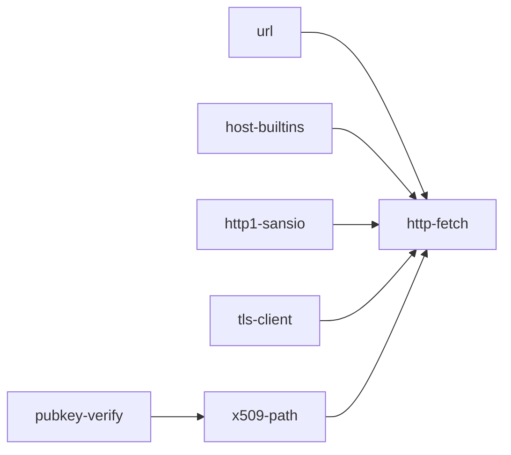

# HTTP/1.1 client for std/net

## Context

[std/net/http1.ts](../../std/net/http1.ts) has a sans-IO request parser (`Http1Parser`) and the response writers (`http1ResponseHead`, `http1WriteResponseHead`, `http1Chunk`) with their CR/LF and token checks (`http1IsToken`, `http1IsFieldText`, `http1BytesAreToken`, `http1BytesAreFieldText`). There is no client side at all. A blocking HTTPS client also needs four things std/net does not have yet:

| Missing | Today | Stage |
| --- | --- | --- |
| name resolution | `netAddress` takes numeric hosts only; LANGUAGE.md's "Not yet" bullet says so | host-builtins |
| a wall clock | `nish:process` has `monotonicNanos` only | host-builtins |
| a URL parser | [std/net/url.ts](../../std/net/url.ts) has percent-decoding and query helpers only | url |
| RSA, P-384 | [std/crypto/x509.ts](../../std/crypto/x509.ts) `x509VerifySignature` handles ecdsa-sha256 on P-256 only | pubkey-verify |
| path validation | no SAN, hostname, validity, constraints or root store | x509-path |
| a TLS client | [std/net/tls.ts](../../std/net/tls.ts) and [std/net/tls-tcp.ts](../../std/net/tls-tcp.ts) are server-only; `tls/codec.ts`, `tls/schedule.ts` and `tls/record.ts` are reusable | tls-client |

## Rescope 2026-10-29

Owner decision at 01:25Z. Other runs are building some of these pieces, so this run yields them and consumes their results.

| Piece | Built by | This run |
| --- | --- | --- |
| RSA, P-384, X.509 extensions, roots, path validation | [#987](https://github.com/amritk/nish/issues/987) tls-chain-validation | pubkey-verify and x509-path **cancelled** (PR #1008 left open as superseded) |
| TLS 1.3 client core and TCP carrier | [#993](https://github.com/amritk/nish/issues/993) tls-client | tls-client **cancelled** (WIP kept on its branch) |
| name resolution | [#986](https://github.com/amritk/nish/issues/986) wp45-dns (`std/net/dns` stub resolver, per `docs/wp45-name-resolution.md`, which rejects `getaddrinfo`) | host-builtins keeps **only the wall clock** |

http-fetch now starts after url, host-builtins and http1-sansio have merged **and** #986's resolver, #987's pki and #993's TCP carrier are on `main`. It is written against their interfaces as merged: it reads them on `main` and does not redefine them. The `TlsServerAuthenticator` sketch below is superseded by whatever #993 and #987 ship. If #993's carrier already validates the chain through #987, http-fetch only supplies roots, the time and the host name. Sections below for the cancelled stages are kept for the record.

## Approach

- **Sans-IO first, IO last.** Every stage but host-builtins and http-fetch is sans-IO and takes its inputs (bytes, the time, the roots) as arguments. Only http-fetch reads the environment, the clock, files and sockets.
- **TLS 1.3 only.** A server that speaks only TLS 1.2 fails with a clear error. TLS 1.2 is out of scope.
- **The TLS client and X.509 never import each other.** `TlsClient` takes a `TlsServerAuthenticator`. http-fetch writes the WebPKI implementation of it on top of `x509VerifyServerChain` and `x509VerifyTlsSignature`. That is what lets tls-client develop in parallel with pubkey-verify → x509-path.
- **Name resolution uses `getaddrinfo`**, as curl's default resolver does, so `/etc/hosts`, nsswitch and resolv.conf behave as users expect. The connect timeout does not bound the lookup, and the guide says so.
- **Verification is variable-time.** It only handles public data (keys, signatures, certificates), so constant-time arithmetic is not needed. The record states this.

## Dependencies and order



Development is blocked only for x509-path, which waits for pubkey-verify to merge, and for http-fetch, which waits for all the others. Wave 1 spawns pubkey-verify, tls-client, http1-sansio and host-builtins. url takes the first free slot.

## Shared files (append-only)

Each stage owns its own files (below). The following are edited by several stages, each adding only its own row, section or path. A textual conflict in one of them is resolved when that stage merges `main` at its turn:

- [docs/security/README.md](../../docs/security/README.md): one Areas row per record.
- [std/README.md](../../std/README.md): one module row per new file.
- [docs/guide/using-nish/standard-library.md](../../docs/guide/using-nish/standard-library.md): one `## nish/...` section per module.
- [THIRD_PARTY_NOTICES.md](../../THIRD_PARTY_NOTICES.md): only if a stage ports code or vectors.
- [.github/workflows/release.yml](../../.github/workflows/release.yml): **only** the new `std/` file paths appended to the three staging lists, which `tests/run.js` checks hold every std module. No other workflow edit is in scope for any stage.

Generated files are regenerated with the repo's tooling and never edited or merged by hand: `tests/self/goldens/checked/**`, `tests/differential/goldens/**` and `tests/differential/emit-ts-known.txt` (regenerate that one only under the Node that `.github/workflows/ci.yml` pins).

## Stage url

**Owns:** `std/net/url.ts`, `tests/link/net_url_*/**`, `docs/security/url.md`, plus its row and section in the shared files.

- `urlParse(s: string): Url | null`. `Url` has `scheme` (lower-cased), `username`, `password`, `host` (lower-cased reg-name, dotted IPv4, or IPv6 without brackets), `port` (−1 when absent), `path`, `query` (null when absent) and `fragment`. Refuse the following: no scheme, a control byte or space anywhere, a port above 65535, an empty host for `http(s)`, a malformed IPv6 literal, and a host with a percent-encoded byte. A refusal returns `null`, never a panic.
- `urlResolve(base: Url, ref: string): Url | null` is RFC 3986 §5.2.2 with §5.2.4 `remove_dot_segments`. `urlSerialize(u)` returns the string form. `urlOrigin(u)` returns the scheme, host and *effective* port (80/443 defaulted), which http-fetch uses for same-origin checks. `urlDefaultPort(scheme)` gives that default.
- Tests: every normal and abnormal example of RFC 3986 §5.4, plus the refusals above. Mirror `tests/link/net_http1`'s layout (`main.ts`, `checks.ts`, `expected.out`) and add `net_url_parse_f64`.

## Stage host-builtins

**Owns:** `src/**`, `runtime/**`, `docs/LANGUAGE.md`, `docs/IR_COOKBOOK.md`, `docs/security/runtime.md`, `docs/guide/using-nish/networking.md`, `tests/cases/**`, `tests/link/net_resolve*/**`, plus the generated files. No other stage touches `src/` or `runtime/`.

Read [.claude/selfhost.md](../selfhost.md) and [.claude/architecture.md](../architecture.md) first. The rolling freeze means `src/` must not *use* either builtin.

- `netResolve(host: string, port: i32, family: i32, out: string[]): i32`. Exact shape is the worker's call, but it should fit `netAddress`. It runs `getaddrinfo` with `AI_ADDRCONFIG` and `SOCK_STREAM` and returns numeric address strings that `netAddress` accepts, in resolver order. The return is a count, or a negative code for each `EAI_*` class (no such name, temporary failure, other). Refuse a host containing NUL, or longer than 253 bytes, before calling libc. On wasm, refuse it like the other `nish:net` builtins (NL2404).
- Wall clock: `nish:process` gains `wallClockSeconds(): i64` and `wallClockNanos(): i64` (`clock_gettime(CLOCK_REALTIME)`), or one of them. Pick the names in keeping with `monotonicNanos`.
- Construct checklist (CLAUDE.md, `docs/ARCHITECTURE.md` → "How to add a construct"): golden `.ll`, `llvm-as` pass, native round trip with expected stdout (resolve `localhost` to a loopback address; a `.invalid` name gives the no-such-name code), negatives (`reject_net_*_wasm`, unknown export), LANGUAGE.md rows, and cookbook entries. Delete the "There is no name resolution" clause from the "Not yet" bullet.
- Security: `docs/security/runtime.md` records the resolver as code that reads the network. Cover its scope, the NUL and length refusals, and what `getaddrinfo` trusts (resolv.conf, the local resolver).

## Stage pubkey-verify

**Owns:** `std/crypto/rsa.ts`, `std/crypto/p384.ts`, `std/crypto/bignum.ts` (if shared arithmetic is split out), `std/crypto/LICENSE-*` (new ones only), `tests/link/crypto_rsa*/**`, `tests/link/crypto_p384*/**`, `docs/security/crypto-rsa.md`, plus its rows and sections in the shared files.

- RSA: `rsaParsePublicKey(spki: u8[]): RsaPublicKey | null` (rsaEncryption SPKI, and RSA-PSS SPKI with or without parameters). Moduli of 2048 to 8192 bits are accepted; smaller is refused. Exponents are odd, ≥ 3 and ≤ 2^32. Add `rsaVerifyPkcs1(key, hashId, message, sig): boolean` and `rsaVerifyPss(key, hashId, message, sig): boolean` with salt length = hash length (the TLS 1.3 rule) and MGF1 with the same hash. Check PKCS#1 v1.5 by **re-encoding and comparing** the whole EM, never by parsing the DigestInfo out of it (the BERserk / Bleichenbacher-06 class).
- P-384: `p384VerifySha384(pub, message, sig)` and `p384VerifySha256(pub, message, sig)`. Public keys are uncompressed SEC1 and on the curve, and signatures are raw `r || s`, as [std/crypto/p256.ts](../../std/crypto/p256.ts) does. DER handling stays in x509.ts.
- Arithmetic may be a small variable-time big-integer module shared by both. A port (for example from BearSSL's `rsa_i31` / `ec_prime_i31`, whose licence is already in `std/crypto/LICENSE-bearssl`) keeps its notice per [.claude/licensing.md](../licensing.md).
- Vectors: RFC 8017 / NIST CAVP SigVer for RSA, NIST CAVP for P-384, and Wycheproof's `rsa_signature_*`, `rsa_pss_*` and `ecdsa_secp384r1_*` subsets. Wycheproof is Apache-2.0: list it in THIRD_PARTY_NOTICES.md. Include malformed lengths, s ≥ n, r = 0 and a point not on the curve. Add f64 twins.

## Stage http1-sansio

**Owns:** `std/net/http1-client.ts`, `std/net/http1.ts` (exporting existing helpers only, no behaviour change), `tests/link/net_http1_client*/**`, `tests/fuzz/targets/http1-client.ts`, `docs/security/http1-client.md`, `docs/guide/using-nish/http-client.md`, `scalar.config.json`, plus its rows and sections in the shared files.

Writer, mirroring `http1ResponseHead` / `http1WriteResponseHead`:

```ts
http1RequestHead(method: string, target: string, names: string[], values: string[], bodyLength: i64 /* -1 = chunked, -2 = none */): u8[] | null
http1WriteRequestHead(out: u8[], off: i32, /* same */): i32   // bytes written, HTTP1_REFUSED or HTTP1_NO_ROOM
```

The method is a token. The target is origin-form, absolute-form or authority-form (for CONNECT), with no byte ≤ 0x20 and no 0x7F. Names are tokens and values are field text, as the response writer requires. Refuse a caller-supplied `Content-Length`, `Transfer-Encoding`, `Host` duplicate or `Connection: upgrade`; the writer owns framing. `Host` is required. Chunked bodies reuse `http1WriteChunk` / `http1Chunk` / `http1LastChunk`.

Parser, mirroring `Http1Parser`'s `feed` / `next` events and sticky error:

```ts
new Http1ResponseParser(maxStatusLine, maxHeaderBytes, maxHeaders, maxBody, maxTrailerBytes)
parser.expect(methodWasHead: boolean, wasConnect: boolean)  // before each response
parser.feed(buf, off, n); parser.next(): i32                 // NEED_MORE, INFORMATIONAL, HEAD, BODY, END, ERROR
parser.finish()                                              // peer closed: ends a read-until-close body, errors otherwise
```

- Status line: `HTTP/1.x SP 3DIGIT SP reason`. Refuse a bare LF, obs-fold, a NUL, or a space before the colon.
- 1xx (except 101) is reported as `INFORMATIONAL` and skipped. A 101 is refused, since the client never asks to upgrade.
- Bodyless: HEAD, 204, 304 and 1xx.
- A 2xx answer to CONNECT ends the response with the tunnel open.
- Framing follows RFC 9112 §6.3. Refuse:
  - `Transfer-Encoding` together with `Content-Length`
  - a `Transfer-Encoding` whose final coding is not `chunked`
  - several `Content-Length` values that differ
  - a non-digit or overflowing length
  - chunk-size overflow, chunk extensions past a limit, and a missing CRLF after chunk data

  With no framing, the body runs until close.
- `keepAlive()` answers whether the connection can carry another request. It is false for HTTP/1.0 without keep-alive, `Connection: close`, read-until-close, or any error.
- Limits: the status line, field-section bytes, field count, body bytes and trailer bytes each have a cap. Exceeding one is a sticky error with a distinct code.
- Tests, mirroring `net_http1`, `net_http1_feed_window` and `net_http1_chunk_window`:
  - every response is parsed whole and again split at every byte boundary, with identical events
  - each smuggling shape above is refused
  - each limit is enforced at exactly cap and cap + 1
  - an f64 twin
  - a fuzz target beside `tests/fuzz/targets/http1.ts`
- Record `docs/security/http1-client.md` (threat model: a hostile server or on-path attacker, with a request built from untrusted strings). Guide page `docs/guide/using-nish/http-client.md`: a sans-IO section, with a route in `scalar.config.json` beside `/networking`. http-fetch adds to this page later.

## Stage tls-client

**Owns:** `std/net/tls-client.ts`, `std/net/tls/record-client.ts`, `std/net/tls/codec.ts` (client-side encoders and decoders added, server behaviour unchanged), `std/net/tls-tcp-client.ts`, `tests/link/net_tls_client*/**`, `tests/run.js` (one new section for the openssl interop only), `docs/security/tls-client.md`, plus its rows and sections in the shared files.

```ts
interface TlsServerAuthenticator {
  // chain[0] is the leaf, DER. 0 accepts; otherwise the TLS alert to send (42 bad_certificate, 45 certificate_expired, 48 unknown_ca, ...).
  verifyChain(chain: u8[][], serverName: string): i32
  // The TLS 1.3 SignatureScheme, the RFC 8446 4.4.3 content, the signature; checked against chain[0]'s key.
  verifySignature(chain: u8[][], scheme: i32, content: u8[], signature: u8[]): boolean
}
```

Handshake details:
- Suites: TLS_AES_128_GCM_SHA256, TLS_AES_256_GCM_SHA384 and TLS_CHACHA20_POLY1305_SHA256.
- Groups: x25519 and secp256r1, with a share for x25519 and HRR for P-256.
- `signature_algorithms`: ecdsa_secp256r1_sha256, ecdsa_secp384r1_sha384, rsa_pss_rsae_sha256/384/512, rsa_pss_pss_*, ed25519, and `signature_algorithms_cert` adding rsa_pkcs1_sha256/384/512.
- SNI is sent for a DNS name and never for an IP literal. ALPN is optional.
- No PSK, 0-RTT, client certificates or TLS 1.2.
- Refuse:
  - a ServerHello that negotiates anything not offered
  - a second HRR
  - a downgrade sentinel in `random`
  - a missing or empty Certificate
  - CertificateVerify before Certificate
  - a bad Finished
  - unexpected messages
  - handshake messages interleaved with alerts or app data
  - a record over 2^14 + 256 bytes
- Secrets are `Secret<T>` and wiped (CLAUDE.md → Security), as on the server side.

`TlsTcpClient` is a blocking carrier over a connected fd, mirroring `TlsTcpServer`: `handshake(deadlineNanos)`, `read(buf, off, n, deadlineNanos)`, `write(...)` and `close()`. It uses `pollWait` with the remaining time and returns a distinct timeout code.

Tests:
- RFC 8448 §3 as the client side (the server side's `net_tls_rfc8448` fixtures exist).
- `TlsClient` against `TlsServer` in one process for each suite and each group, HRR included, plus each refusal.
- A `tests/run.js` section against `openssl s_server` (P-256 and RSA-PSS certs) when `openssl` is present, skipping like `net_tls_tcp` does when it is absent.
- f64 twins.
- `net_tls_client_wipes`, mirroring `net_tls_wipes`.

## Stage x509-path

**Owns:** `std/crypto/x509.ts`, `std/crypto/x509-verify.ts`, `tests/link/crypto_x509_path*/**`, `tests/link/crypto_x509/**` (only if an existing check's expectation changes), `docs/security/crypto-x509.md`, plus its rows and sections in the shared files. **Depends on pubkey-verify being merged before it starts.**

- Extensions: SAN dNSName and iPAddress, basicConstraints (cA, pathLenConstraint), keyUsage, extKeyUsage and nameConstraints (dNSName permitted/excluded). An unrecognised **critical** extension fails validation. A duplicated extension fails parsing.
- Signature dispatch for certificates covers ecdsa-with-SHA256/384 on P-256/P-384, sha256/384/512WithRSAEncryption, RSASSA-PSS and Ed25519. Anything else is unsupported, and validation fails.
- `x509VerifyTlsSignature(leaf, scheme, content, sig)` maps TLS 1.3 SignatureSchemes to the above. It refuses rsa_pkcs1_* (forbidden in CertificateVerify) and a scheme/key mismatch.
- `x509ParseRootStore(pem: string): X509RootStore`. A PEM bundle like `/etc/ssl/certs/ca-certificates.crt` gives its parsable certificates. An unparsable entry is skipped and counted, not fatal.
- `x509VerifyServerChain(chain: u8[][], host: string, nowSeconds: i64, roots: X509RootStore): i32` returns 0 or a code that maps to the TLS alerts above. It:
  - builds a path from the leaf through the supplied intermediates (order-tolerant, deduplicated, depth ≤ 8, loops refused) to a root matched by subject and key
  - checks each signature and validity at `nowSeconds`
  - checks CA and pathLen on issuers and keyCertSign where keyUsage is present
  - checks serverAuth EKU on the leaf when EKU is present
  - checks name constraints
  - matches the host per RFC 6125: SAN only, no CN fallback; a wildcard only as the whole left-most label and never over a public-suffix-free two-label name; IP hosts match iPAddress SANs only
- Tests: minted chains (existing `x509MintSelfSigned` style, extended to issue under a CA). Cover:
  - each refusal: expired, not yet valid, wrong host, wildcard abuse, non-CA issuer, pathLen exceeded, EKU clientAuth only, unknown critical extension, untrusted root, broken signature, a loop
  - a captured real-world chain fixture (RSA root, P-384 or RSA intermediate, ECDSA or RSA leaf) validated at a fixed time
  - an f64 twin

## Stage http-fetch

**Owns:** `std/net/http-client.ts`, `tests/link/net_http_fetch*/**`, `examples/http-get-json.ts`, `docs/security/http-client.md`, `docs/guide/using-nish/http-client.md` (after http1-sansio merges), `llms.txt` and `docs/AI.md` (std module mentions only), plus its rows and sections in the shared files and the generated goldens for the new example. **Starts after all other stages have merged.**

```ts
class HttpRequest  { method; url: string; headers names/values; body: u8[] | null }
class HttpOptions  { connectTimeoutMs = 10000; readTimeoutMs = 30000; totalTimeoutMs = 0 /* none */; followRedirects = false; crossOriginRedirects = false; maxRedirects = 5; maxHeaderBytes; maxBodyBytes; useEnvProxy = true; rootsPemPath: string | null }
class HttpResponse { status: i32; reason; header(name): string | null; body: HttpBodyReader; url: string /* after redirects */ }
class HttpBodyReader { read(buf, off, n): i32  /* >0 bytes, 0 end, <0 error code */; readAll(limit): u8[] | null }
class HttpClient   { constructor(options); fetch(req): HttpResponse | null; error: i32; errorText: string; close() }
httpFetch(req, options): HttpResponse | null   // one-shot convenience over a throwaway HttpClient
```

- **Errors** are distinct codes with text for each of these: DNS, connect refused, connect timeout, TLS handshake (with the alert), certificate (with the x509 code), read timeout, total timeout, protocol (with the parser code), too many redirects, redirect refused (cross-origin when not allowed), body too large and proxy refused (CONNECT non-2xx).
- **Dialing**: `netResolve`, then try each address in order with a non-blocking connect bounded by the connect timeout. For https, wrap the socket in `TlsTcpClient` with a WebPKI `TlsServerAuthenticator` written here over `x509VerifyServerChain` / `x509VerifyTlsSignature`. The roots come from `rootsPemPath`, then `SSL_CERT_FILE`, then the first readable of `/etc/ssl/certs/ca-certificates.crt`, `/etc/pki/tls/certs/ca-bundle.crt` and `/etc/ssl/cert.pem`. The time comes from the wall-clock builtin. With no roots found, an https fetch fails with a clear error. It never proceeds unverified, and there is no "insecure" switch.
- **Deadlines**: the read timeout bounds each wait for bytes. The total timeout bounds the whole fetch including redirects and the body reader. Both use `monotonicNanos`.
- **Keep-alive**: `HttpClient` holds at most one connection. A new fetch to the same origin (and the same proxy route) reuses it when the previous response was fully read and `keepAlive()` was true. Otherwise it closes it and dials again. A reused connection that fails before any response byte is retried once on a fresh connection, for idempotent methods only.
- **Redirects** (301, 302, 303, 307, 308) are followed only when `followRedirects` is set. Location is resolved with `urlResolve`. A cross-origin hop is refused unless `crossOriginRedirects` is set. When one is followed, `Authorization`, `Proxy-Authorization` and `Cookie` are dropped. An https→http hop is always refused. 303 (and 301/302 after POST) becomes GET without a body. 307 and 308 keep the method and body.
- **Proxies**:
  - `HTTPS_PROXY`/`https_proxy` for https URLs uses CONNECT `host:port` with a Host header, then TLS to the origin through the tunnel.
  - `HTTP_PROXY`/`http_proxy` for http URLs uses absolute-form.
  - `NO_PROXY`/`no_proxy` is comma-separated: `*`, an exact host, a domain suffix with or without a leading dot, and an IP literal. The port is optional. Hosts are compared case-insensitively.
  - Proxy userinfo is sent as `Proxy-Authorization: Basic`.
  - Only `http://` proxies are accepted. An `https://` proxy URL is refused with a clear error.
  - `HTTP_PROXY` is ignored when `REQUEST_METHOD` is set (httpoxy).
- **Body reader** hands out bytes as the parser produces them, with no buffering of the whole body, so a caller can split Server-Sent Events or JSON lines as they stream.
- **Tests**: in-process loopback servers, using the `tests/link/net_http1_server/harness.ts` and `net_loopback` patterns. Cover:
  - each behaviour above
  - a stalling server (read timeout) and a non-routable address or full backlog (connect timeout)
  - one accept for two keep-alive requests
  - a CONNECT proxy that records what it saw (Authorization never crosses origins)
  - an SSE server whose events are read before it closes
  - an https loopback through `TlsServer` with a minted CA passed via `rootsPemPath`
  - NO_PROXY matching via a test-only entry point that takes the environment values as arguments
- **Example**: `examples/http-get-json.ts <url>` GETs an HTTPS JSON API (the guide uses `https://api.github.com/repos/amritk/nish`), parses it with `std/json` and prints a few fields. With no argument it prints usage and exits 2 (`// smoke: exit 2`, like `examples/prefork-server.ts`), so CI's smoke never needs the internet.
- **Record** `docs/security/http-client.md` covers response splitting (request writer refusals), smuggling (parser framing refusals), size limits, redirect and credential handling, proxy handling, the TLS trust decision, and what `getaddrinfo` and the root bundle are trusted for.

## Out of scope

- TLS 1.2, client certificates, session resumption and 0-RTT.
- HTTP/2 for the client, and connection pools beyond one connection.
- Cookies, decompression and `Expect: 100-continue` (a 100 is still skipped if a server sends one).
- An async/event-loop client.
- DNS over anything but `getaddrinfo`.
- Revocation (OCSP/CRL) and Certificate Transparency checks for client-side verification.

## Verification

Each stage's `verification` line, plus the repo's definition of done: `npm run lint:dead`, and every CI `test (…, shard N/4)` row green and undegraded on the PR head.

## Acceptance criteria

1. `nish run examples/http-get-json.ts https://api.github.com/repos/amritk/nish` (through the environment's `HTTPS_PROXY` when one is set) exits 0 and prints fields read from the live JSON response.
2. Against hosts with an expired certificate, a certificate for another name, and a self-signed certificate, `httpFetch` returns no response, and its error names the certificate failure. Run with no roots available, it refuses rather than connecting unverified.
3. A program that asks the request writer for a header name or value containing CR, LF or NUL, or a target containing a space, gets a refusal and no bytes.
4. The response parser gives identical results for a response fed whole and split at every byte boundary. It handles Content-Length, chunked with trailers and read-until-close bodies. It skips 1xx and gives no body for HEAD, 204 and 304. It refuses Content-Length together with Transfer-Encoding, conflicting Content-Lengths, and responses over each size limit.
5. Reading an SSE or JSON-lines response from a server that sends events seconds apart, a program receives each event before the server finishes the response.
6. A connect to an unreachable address, a server that stops sending, and a fetch exceeding its total budget each fail within their configured timeout with distinct errors.
7. Two sequential fetches to one origin through one `HttpClient` use one TCP connection.
8. A same-origin redirect is followed when redirects are on, and a cross-origin redirect is refused by default. When cross-origin is allowed, the Authorization header does not reach the new origin.
9. With `HTTPS_PROXY` set, an https fetch tunnels through CONNECT on the proxy. A host matched by `NO_PROXY` connects directly, and `HTTP_PROXY` serves http URLs.
10. The guide has an HTTP client page reachable from the docs site's navigation. `docs/security/` has the client's record covering response splitting, smuggling and size limits. `node scripts/security-scope.mjs` passes with every new `std/net` and `std/crypto` file in scope.
