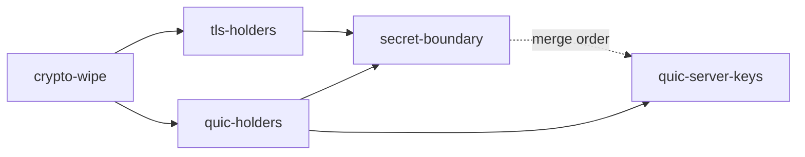

## Context

[#430](https://github.com/amritk/nish/issues/430) asks that TLS and QUIC key material be `nish:secret` material that is wiped when a connection or epoch ends. Today, on `main` at `b515c1b`:

| Holder | Secret fields | Wiped today |
|---|---|---|
| `AesKey` ([aes.ts:120](../../std/crypto/aes.ts)) | `roundKeys` (kernel layout, H powers at [240,304), Karatsuba operands at [304,368)), `hHi`, `hLo` | ordinary stores, in [`tlsClearAesKey`](../../std/net/tls/record.ts) (record.ts:189) and [`quicPacketClearAes`](../../std/net/quic-packet.ts) (quic-packet.ts:1115) |
| AES working copies | `aesScheduleInto`'s `w`/`q`/`buf`, `aesBlockInto`'s `buf`, `aesKeyInto`'s `h` | not wiped, or ordinary loops |
| ChaCha | keys are byte arrays (`secureZero`'d by holders); per-call `state`, `polyKey`, `r`, `h` | per-call state never wiped |
| `TlsRecordProtection` / `TlsRecordServer` / `TlsServer` | key, IV, AES schedules, traffic, exporter, resumption secrets, `TlsExchangeWords` | `secureZero` for bytes, ordinary stores for schedules and words; resumption secret only at `restart`; traffic keys not on `fail` |
| `QuicKeysSlot` / `QuicConnection` | packet, IV, HP keys, four `AesKey`s per slot | `secureZero` plus ordinary stores; a key update leaves the replaced `packetAes`; `close`/`fail` wipe nothing until release |
| Allocating derivations (`tls*` in schedule.ts, `quicKeys*`) | answers are plain `u8[]` / `QuicKeys` | never; used by tests only, std uses the `*Into` forms |

Records: TLS-1, TLS-2 ([tls.md](../../docs/security/tls.md)), QUIC-1, QUIC-2 ([quic.md](../../docs/security/quic.md)), AEAD-4 ([crypto-aead.md](../../docs/security/crypto-aead.md)), K1-7 ([crypto-k1.md](../../docs/security/crypto-k1.md)).

## Approach

**A `Secret` may not be a field (NL2430), an element, or a type argument (NL2429)**, and that is right for these holders: `QuicKeysSlot` lives in `QuicConnSpace.keySlots`, inside `QuicConnection`, inside `Http3Server.quics[]`, and every per-packet seal would have to run through `exposeWith`, whose function may not write the caller's datagram (NL2450). So "the keys are `Secret<T>`" means two things, each true and each pinned:

1. **At the boundary, the type.** Every one-shot derivation takes its secret as a borrowed `Secret<u8[]>` and answers a secret as `Secret<u8[]>`, computing inside `expose`, on the pattern `hmacSha256Secret` and `hkdfExpandSha256Secret` set in #476 (Stage 4).
2. **In a holder, the wipe.** A key a connection keeps across calls lives in exactly one owner's integer arrays, and every end-of-life point (named per stage) runs `wipe`, the `Secret`'s own volatile `llvm.memset` over the array's whole capacity. `wipe` already accepts a plain `u64[]`/`u32[]`/`u8[]` field with no compiler change: `std/crypto/hmac.ts:104-115` does it. `secureZero` stays where it already wipes a `u8[]` (it survives `-O2` as a call to `nish_wipe`); every **ordinary-store** wipe becomes `wipe`.

No compiler change: `src/` is untouched, so the rolling freeze does not apply.

**Pins.** Each wipe root is counted after `opt -O2` the way the HMAC/HKDF check counts them (`tests/run.js:6052-6160`: volatile `llvm.memset … i1 true` plus `call @nish_wipe`, exact count per root). Each stage also reads every wiped array back as zero at run time in a **new** link test, so the existing `expected.out` files stay byte-identical.

**Order.** Stage 1 introduces `aesKeyWipe`, the H field and the harness, which Stages 2 and 3 consume, so they start once it merges. Stages 2 and 3 are disjoint (TLS files against QUIC files) and run in parallel. Stage 4 changes signatures both of them call, so it starts once both merge. Stage 5 starts once Stage 3 merges and runs beside Stage 4 (disjoint code files), merging after it: the two share only their own rows of `docs/security/quic.md`, `docs/security/README.md`, `std/README.md` and the guide's standard-library page.



## Stage 1 — crypto-wipe

**Owns:** `std/crypto/aes.ts`, `std/crypto/chacha20poly1305.ts`, `std/crypto/hkdf.ts`, `std/README.md`, `tests/run.js`, `tests/wipes/**` (new), `tests/link/crypto_*/**`, `tests/link/net_quic_memory/units.ts` (an `hHi`/`hLo` reader), `tests/cases/ct_asm_aes*` (only if the H field moves its copy), and the generated goldens (`tests/self/goldens/checked*.txt`, `tests/differential/goldens*`)

**AesKey's H.** `hHi`/`hLo` are scalars, which `wipe` cannot reach and a record wipe cannot reach either, since `AesKey` also holds an array. Replace them with `h: u64[]` (2 words, hi then lo), and read it wherever the bitsliced GHASH and J0 read the two fields. The kernel path keeps reading H's powers from `roundKeys`. Output is unchanged. `crypto_aes_agree/expected.ir` pins SSA numbers in `aes.ts`; regenerate it only if the seam calls' numbering moves, and read its diff.

**aesKeyWipe.** `export const aesKeyWipe = (key: AesKey): void` runs `wipe(key.roundKeys)` (its whole capacity: 704 or 960 bytes, kernel tail included) and `wipe(key.h)`. `rounds` is not secret.

**Working copies.** Wipe `aesScheduleInto`'s `w`, `q` and `buf`, `aesBlockInto`'s `buf` and `aesKeyInto`'s `h` with `wipe` once they are dead. The seam calls into `runtime/runtime-aes.c` (`nish_aes_schedule`, `nish_aes_block`) are untouched; on a CPU with the instructions the seams run the kernels and these wipes reach only the bitsliced fallback's arrays.

**ChaCha.** Wipe the per-call `state`, `polyKey`, `r` and `h` in `chacha20poly1305.ts` (lines 592-668) before each seal and open returns, on every path, the failure path included.

**HKDF label.** `hkdfExpandLabelSha256Secret(prk: Secret<u8[]>, label: string, context: u8[], length: i32): Secret<u8[]>` and its `Sha384` twin, beside `hkdfExpandSha256Secret` (hkdf.ts:254). Stage 4 builds on them.

**The -O2 harness.** Move the HMAC/HKDF check's body (`optimisedModules`, `wipesUnder`, the root table) into `tests/wipes/index.js`. `run.js` imports it and runs one check per area file: `tests/wipes/crypto.js` (HMAC, HKDF, now AES and ChaCha), `tests/wipes/tls.js`, `tests/wipes/quic.js` and `tests/wipes/quic-server.js` (each exporting an empty root list for Stages 2, 3 and 5 to fill). The existing check names stay exactly as they are; an area's check is named `<area>: the wipes survive opt -O2 (…)`. After this stage, no later stage edits `tests/run.js` or `tests/wipes/index.js`.

**Docs.** `std/README.md`'s `crypto/aes.ts` and `crypto/hkdf.ts` rows.

## Stage 2 — tls-holders

**Owns:** `std/net/tls.ts`, `std/net/tls/record.ts`, `std/net/tls/record-server.ts`, `std/net/tls-tcp.ts`, `tests/wipes/tls.js`, `tests/link/net_tls_wipes/**` (new), `docs/security/tls.md`, the TLS rows of `docs/security/README.md`, and the generated goldens

**Record protection.** `TlsRecordProtection.clear` calls `aesKeyWipe` on `aes128` and `aes256`; delete `tlsClearAesKey`.

**TlsServer.** `TlsExchangeWords` is all integers: replace the per-word ordinary stores (tls.ts:499-502, :1168-1173) with one `wipe(w)` where every word is dead, keeping its TLS-3 arena scope. The resumption master secret, which nothing reads (tickets are out of scope), is wiped when the connection ends, not only at the slot's next `restart`.

**TlsRecordServer.** `fail` (record-server.ts:963) wipes the traffic keys and secrets too, not only the handshake's, since a failed connection sends nothing more under them. Check the one alert `fail` may still write is sealed before the wipe.

**Records.** TLS-2 closes. TLS-1 narrows to the schedule's one-shot answers (Stage 4) and the HKDF/HMAC intermediates the `*Into` forms already wipe. Each rewritten row names the commit its anchors are at.

## Stage 3 — quic-holders

**Owns:** `std/net/quic.ts`, `std/net/quic-packet.ts` (the slot and connection part; no signature changes), `std/net/quic-listener.ts` (only if a wipe root lives there), `tests/wipes/quic.js`, `tests/link/net_quic_wipes/**` (new), `docs/security/quic.md`, the QUIC rows of `docs/security/README.md`, and the generated goldens

**Key slots.** `QuicKeysSlot.wipe` (quic-packet.ts:1101) calls `aesKeyWipe` on its four schedules; delete `quicPacketClearAes`.

**Key update.** `updateWriteKeys` (quic.ts:1880) and `prepareNextReadKeys` (:1912) wipe the replaced generation's `packetAes` beside `quicConnWipePacketKey`.

**Connection end.** A connection that `close`s (:1419) or `fail`s (:1403) must keep the keys it needs to resend CONNECTION_CLOSE through the closing period (RFC 9000 §10.2.1), so the wipe runs when the closing or draining period ends, and in `wipeAll` as today. A closed connection skips `runClocks` (:2733), so the period's end has to be reachable for it, or `wipeAll` runs at the point the connection can no longer send. The `net_quic_*` and `net_http3*` outputs, and the interop lanes' `keyupdate` and `chacha20` cases, prove nothing sent changed.

**Records.** QUIC-2 closes. QUIC-1 stays for Stage 4.

## Stage 4 — secret-boundary

**Owns:** `std/net/tls/schedule.ts`, `std/net/quic-packet.ts`, `std/net/quic.ts` (only callers of a migrated function), `std/net/tls.ts` (likewise), `tests/link/net_tls_*/**`, `tests/link/net_quic_*/**`, `tests/cases/reject_*` (new negatives), `std/README.md`, `docs/guide/using-nish/standard-library.md`, `docs/security/tls.md`, `docs/security/quic.md`, `docs/security/crypto-aead.md`, `docs/security/crypto-k1.md`, `docs/security/README.md`, and the generated goldens

**TLS schedule.** The allocating functions in schedule.ts (lines 100-170) take a secret input as `Secret<u8[]>` and answer a secret as `Secret<u8[]>`, built on `hkdfExtractSha256Secret`, `hkdfExpandLabelSha256Secret` and their `Sha384` twins. Non-secret inputs (transcript hashes, labels) stay plain. The `*Into` forms std itself uses are not changed.

**QUIC keys.** `quicKeyUpdateSecret(aead, secret: Secret<u8[]>): Secret<u8[]> | null`. `quicKeys(aead, secret: Secret<u8[]>)` and `quicKeysUpdate(keys, next: Secret<u8[]>)` still answer a `QuicKeys` (a holder, which cannot be a `Secret`), and `quicKeysWipe(keys)` wipes every array in it, `aesKeyWipe` included. The Initial secrets stay plain (public by RFC 9001 §5.2); a caller deriving Initial keys wraps a copy.

**Callers.** Only tests call the allocating forms. Each caller holds a `Secret` in a local and wipes it, or passes it on. Every `expected.out` stays byte-identical.

**Records.** TLS-1 and QUIC-1 close, or narrow to what no wipe reaches (a scalar in a register, an immutable string). K1-7's remainder narrows. AEAD-4's note now says that `rk` (H's powers included) and H are wiped by `aesKeyWipe`'s volatile store whenever TLS and QUIC drop a key, and that the vector registers and their spills stay out of reach. The index rows follow.

**Docs.** `std/README.md` rows for `net/tls`, `net/quic-packet`; the guide's standard-library page where it shows these signatures.

## Stage 5 — quic-server-keys

**Owns:** `std/net/quic-listener.ts`, `std/net/http3-server.ts`, `tests/wipes/quic-server.js`, `tests/link/net_quic_server_wipes/**` (new), the QUIC-5 row of `docs/security/quic.md` and of `docs/security/README.md`, the `net/quic-listener` and `net/http3-server` rows of `std/README.md`, the `Http3Server` text of `docs/guide/using-nish/standard-library.md`, and the generated goldens. Not `std/net/quic.ts`: `QuicServerConfig`'s shape does not change.

**Listener.** `QuicListener` (quic-listener.ts:295) holds `seed`, `readSlot`/`writeSlot`, `tag` and `kdf` for the server's life and has no end. Add `release()`, which wipes each with `wipe` (or `secureZero` where it already applies), after which the listener answers nothing.

**Server.** `Http3Server` has no stop. Add one release path that releases every connection (their `wipeAll`) and the listener, and wipes `statelessResetKey` and `retryTokenKey` (quic.ts:479-481). Once handed to the server those two arrays are the server's: the doc comment says so, so a caller that keeps a copy wipes its own. Retry tokens and stateless resets the server issues before release are unchanged byte for byte.

**Records and docs.** QUIC-5 closes, or narrows to the caller's own copies, which the server cannot reach. `std/README.md` and the guide page document `release`.

## Out of scope

- Session tickets, NewSessionTicket, PSK and 0-RTT.
- Any change to the AES kernels: `runtime/runtime-aes.c`, the seam calls, the kernel layout.
- A language change: lifting NL2430/NL2429 to allow a `Secret` field.
- Threading QUIC-5's keys through the API as borrowed `Secret`s (a `QuicServerConfig` shape change).
- The vector registers and their spills (AEAD-4) and the `debug` profile's `-O0`.

## Tests

Every stage:

- **-O2 pin.** Roots in its `tests/wipes/<area>.js`, exact volatile-wipe counts after `opt -O2`, beside a twin or count that shows an ordinary store would have been dropped where that is true. Check names are greppable and the record's Tests list names them exactly (CLAUDE.md, Security).
- **Read-back.** A new link test (`crypto_aes_wipes`, `net_tls_wipes`, `net_quic_wipes`, `net_quic_server_wipes`) drives each end-of-life point and prints that every array it wiped reads zero, kernel tail and H included, with `expected.out` and an `_f64` twin where the area has one.
- **Byte-identical.** No existing `tests/link/*/expected.out` line changes. `git diff origin/main -- 'tests/link/*/expected.out'` lists only new directories.
- **Negative.** Stage 4 adds at least one refusal of a plain `u8[]` where a migrated derivation takes a `Secret`.
- **Interop.** `.github/workflows/interop.yml` (quic-interop-runner against quic-go and ngtcp2, keyupdate and chacha20 included; h2spec; curl HTTP/2 and HTTP/3; Chrome WebTransport) is green on the PR's head.

## Verification

```bash
bash scripts/fetch-seed.sh --force
npm run check
npm run lint
node tests/run.js                       # undegraded: read the skip count and the DEGRADED banner
node tests/run.js wasi                   # read its skip line; WASI_SYSROOT=/usr if needed
node tests/run.js performance
node tests/self/goldens.js --update      # then read the diff before committing it
node tests/differential/goldens.js --update   # when a positive tests/cases file is added
```
