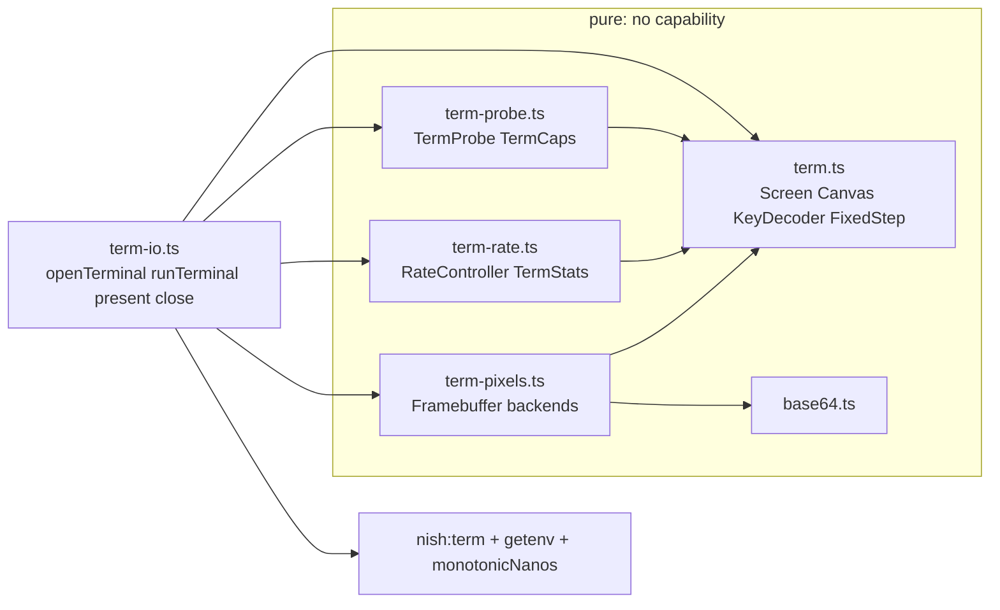

## Context

[`std/term.ts`](../../std/term.ts) is a pure terminal core: `Screen` (double-buffered cells, `flush()` diffs, `palette256`), `Canvas` (half-block pixels), `KeyDecoder` (arrows, Enter, Space, Escape, Ctrl-C, characters), `FixedStep` (`advance`, `alpha`), `beginSync`/`endSync` and the mode escapes. It reaches no capability (`tests/link/std_term/args` denies every one) and prints the same bytes under Node. `nish:term` ([`runtime/nish.d.ts`](../../runtime/nish.d.ts)) has `readStdin` (never blocks, -11), `waitStdin`, `isTerminal`, `terminalSize` (cells only) and `setRawMode` (ISIG kept; termios restored at exit, panic and fatal signals by [`runtime/runtime-term.c`](../../runtime/runtime-term.c)). Every program today decides colour depth, sync, timing and input by hand, and a crash leaves escape-sequence modes on.

## Approach

- **Pure core, one I/O layer.** Every decision lives in a pure module fed numbers and bytes, golden-tested and identical under Node. Only `std/term-io.ts` calls `nish:term`, `getenv` and `monotonicNanos`. The pure modules' link cases run with every capability denied.
- **Modules.** `std/term.ts` (core, extended), `std/term-probe.ts`, `std/term-rate.ts`, `std/term-pixels.ts`, `std/base64.ts`, `std/term-io.ts`. Separate files let four stages run at once. Nish has no re-exports, so a program that wants only the loop imports `nish/term-io` alone; it re-states nothing the others define but its own API.
- **Registered once.** A new `std/` module must be named in `src/std-modules.ts` and in the three presence gates of `.github/workflows/release.yml` (`tests/run.js` checks both). The first stage registers all five with header-only stubs, so later stages touch no `src/` and no workflow.
- **No function values.** Nish allows a function-typed parameter only on a top-level function, and an arrow captures nothing, so the loop is the top-level generic `runTerminal<G>(options, state: G, update, render)`, with the program's state passed through `state`. The open and close pair are `openTerminal(options)` and `term.close()`. If static methods turn out to be supported, `Terminal.open` may alias `openTerminal`; it must not replace it.
- **Errors are values.** `openTerminal` answers a `Result` whose error is one sentence (for example "stdin is not a terminal (a pipe or CI?)"), never a panic, so the guide program prints it and exits 1.
- **Measure the terminal, not write().** After each frame, the I/O layer sends one ack query and times its reply. Replies are parsed by the same `KeyDecoder` as keys (one decoder), and handed to the controller rather than the program.
- **Multiplexers answer for themselves.** tmux, screen and mosh answer DA1 and DSR from their own emulators, so inside them the ack measures the multiplexer, not the outer link. Each of them already drops or coalesces redraws when its client falls behind. The controller still bounds frame cost and bytes. The guide says this plainly, and the worker for `term-rate` confirms from tmux's and mosh's sources which of CSI 5n and CSI 6n each one answers, and cites them.



## Restore builtin

**Owns:** `src/**`, `runtime/**`, `tests/run.js`, `tests/capabilities.js`, `tests/c-symbols/**`, `tests/runtime/**`, `tests/cases/*term_restore*`, `docs/LANGUAGE.md`, `docs/IR_COOKBOOK.md`, `docs/cookbook/builtin-term.ts`, `docs/RUN_UNDER_NODE.md`, `docs/guide/using-nish/terminal.md`, `docs/guide/using-nish/cli.md`, `.github/workflows/release.yml`, `std/term-probe.ts`, `std/term-rate.ts`, `std/term-pixels.ts`, `std/term-io.ts`, `std/base64.ts`, `std/README.md`

This stage lands in its own first commit, as the request asks. `src/` will not call the builtin, so the rolling freeze does not apply. Its interface is fixed here because `term-io` depends on it:

```ts
declare module "nish:term" {
  /**
   * Bytes the runtime writes to the terminal on stdout at exit, on a panic and on every
   * signal that ends the program (SIGKILL aside), before termios is restored. Replaces
   * the previous string; "" clears it. 0, -25 when stdout is not a terminal, -7 (E2BIG)
   * past NISH_TERM_RESTORE_MAX bytes.
   */
  export function setTerminalRestore(bytes: string): i32;
}
```

- Copy the bytes into a static buffer when the program sets them, capped at a size the worker chooses and documents (4096 is ample for every reset this plan writes). The signal handler then only calls `write(2)` in a loop on EINTR and a short write, with no allocation and no lock it does not already take. Publish the length last, with a `sig_atomic_t` or an atomic store, so a signal that arrives during an update writes either the old string or the new one, never half of each.
- Write the string once per exit. A normal exit that already called `setTerminalRestore("")` writes nothing.
- Follow `setRawMode` on each target: under Node it throws (tty capability), and under WASI it answers -25 and stores nothing. Carry the `tty` capability, and add the symbol to every list that names `nish_set_raw_mode` (`tests/c-symbols`, the runtime budgets, `--emit-ts` edits).
- **Tests:** `tests/cases/term_restore.ts` with its `.ll` golden and `.out`, `llvm-as` and a native round trip. A PTY check in the `term` section of `tests/run.js`: set a string, exit, panic, SIGTERM and SIGSEGV, and check that the bytes after the last output are exactly the string, written once, and that `stty -g` matches. Negative cases `reject_term_restore_arity`, `reject_term_restore_number` and `reject_term_restore_wasm` mirror the `reject_term_*` set, plus the over-cap -7 case. Show the exact IR for each TypeScript snippet the PR adds.
- **Docs:** the builtin's rule in `docs/LANGUAGE.md` (Builtin modules), its IR in `docs/IR_COOKBOOK.md` and `docs/cookbook/builtin-term.ts`, Node behaviour in `docs/RUN_UNDER_NODE.md`, and a short section on the guide page `docs/guide/using-nish/terminal.md`. `term-io` rewrites that page later.
- Regenerate `tests/self/goldens/checked/` and `tests/differential/goldens/`, and run `node tests/run.js wasi` (read its skip line) and `node tests/run.js performance`.

## Module registration

Part of `restore-builtin`. Add `base64`, `term-io`, `term-pixels`, `term-probe` and `term-rate` to the sorted literal in `src/std-modules.ts`, and `std/<name>.ts` to each of the three `for f in` presence gates in `.github/workflows/release.yml`, changing nothing else in that file. Create each module as a stub that holds only its `/** ... */` header, saying what the module will hold and that the stage named in this plan fills it, plus the smallest export the compiler accepts if it refuses an empty module. Add the stubs' rows to `std/README.md` only if a check requires them. Each later stage owns its own stub.

## Events

**Owns:** `std/term.ts`, `tests/link/std_term/**`, `tests/link/std_term_f64/**`, `tests/link/std_term_buffers_disagree/**`, `tests/link/reject_term_feed_string/**`, `tests/link/std_term_events*/**`

Extend `KeyDecoder`, not a second decoder. `feed` and `poll` keep their documented results byte for byte, so the existing goldens hold. New methods answer the richer stream from the same parser:

```ts
export const EVENT_KEY: i32 = 1      // key, modifiers, action
export const EVENT_MOUSE: i32 = 2    // button, action, x, y in cells, px, py (-1 without 1016)
export const EVENT_PASTE: i32 = 3    // text: everything between ESC[200~ and ESC[201~
export const EVENT_FOCUS: i32 = 4    // gained true or false
export const EVENT_RESIZE: i32 = 5   // made by term-io, never by the decoder
export const EVENT_REPLY: i32 = 6    // a terminal answer; never handed to a program by term-io
export const EVENT_QUIT: i32 = 7     // made by KeyState's Ctrl-C mapping
export const ACTION_PRESS = 1, ACTION_REPEAT = 2, ACTION_RELEASE = 3
export const MOD_SHIFT = 1, MOD_ALT = 2, MOD_CTRL = 4, MOD_SUPER = 8  // the kitty bit values minus one
export class TermEvent { type; key; code; modifiers; action; button; x; y; px; py; text; reply; params: i32[]; gained }
KeyDecoder.feedEvents(bytes: u8[], count: i32, nowMs: f64): TermEvent[]
KeyDecoder.pollEvents(nowMs: f64): TermEvent[]
```

- **Keys:** the kitty protocol `CSI code ; mods : event u`, plus its legacy `CSI 1 ; mods A–D/H/F`, `CSI n ; mods ~` and `SS3` forms. Plain bytes keep today's meaning. Add named keys for F1–F12, Home, End, PageUp, PageDown, Insert and Delete.
- **Mouse:** SGR 1006 `CSI < b ; x ; y M/m` with button, wheel, drag and modifiers. Under 1016 the same sequence carries pixels, and the decoder is told which mode is on through a flag.
- **Paste:** everything between `ESC[200~` and `ESC[201~` becomes one event. It may span any number of reads and is never decoded as keys.
- **Focus:** `CSI I` and `CSI O`.
- **Replies:** DA1 `CSI ? … c`, DA2 `CSI > … c`, DSR `CSI 0 n`, CPR `CSI r ; c R`, DECRPM `CSI ? n ; v $ y`, kitty keyboard `CSI ? flags u`, XTSMGRAPHICS `CSI ? i ; s ; v S`, window reports `CSI 4|6|8 ; a ; b t`, kitty graphics `APC G … ST` and XTVERSION `DCS > | … ST`. Each becomes an `EVENT_REPLY` with its final byte, prefix and params. A reply is never a key. An unterminated DCS, APC or OSC is held under the same timeout rules and then dropped, not turned into keys. CPR `CSI r;c R` collides with F3 plus modifiers in legacy xterm (`CSI 1;mods R`). Disambiguate it the documented way, by the decoder knowing whether a CPR is outstanding through a counter `term-io` raises, and pin the case with a test.
- **KeyState** (pure; the clock is the caller's) holds `isDown(key)` and `releasesAreSynthetic`. `apply(events, nowMs)` tracks presses. Under kitty it uses the real releases. Without kitty it synthesizes a release once no repeat has arrived for `releaseGapMs`, 100 by default; the first auto-repeat delay is about 250–500 ms, so the gap applies after the first repeat and a longer initial window applies before it. `tick(nowMs)` emits the synthesized releases. With `quitOnCtrlC` set (the default), it maps Ctrl-C to `EVENT_QUIT`, both as byte 3 and as kitty's `CSI 99;5u`.
- **Tests:** `tests/link/std_term_events` uses `Suite` to cover every form above, each fed whole, at every split point, and one byte per `feed`. It also covers a paste holding ESC and newlines, replies interleaved with keys, synthesized and real releases, and the quit mapping. `std_term` and `std_term_f64` goldens stay byte-identical except the `term.ll` module golden, which is regenerated.

## Probe

**Owns:** `std/term-probe.ts`, `tests/link/std_term_probe*/**`

- `TermEnv` is a record of the strings `term-io` reads with `getenv`: `TERM`, `COLORTERM`, `TERM_PROGRAM`, `TMUX`, `STY`, `SSH_CONNECTION`, `SSH_CLIENT`, `SSH_TTY`, `NO_COLOR`, `NISH_TERM_GRAPHICS` and `NISH_TERM_FPS`, with "" for unset. Everything here is a pure function of it plus the replies.
- `probeQueries(env, cols, rows): string` is one write. It holds XTVERSION `CSI > q`, DECRQM `CSI ? 2026 $ p` (sync) and `CSI ? 1016 $ p` (pixel mouse), kitty keyboard `CSI ? u`, kitty graphics `APC G i=31,s=1,v=1,a=q,t=d,f=24;AAAA ST`, XTSMGRAPHICS `CSI ? 1 ; 1 ; 0 S`, `CSI 16 t`, `CSI 14 t`, and the true-colour check (DECRQSS of a set SGR, or the terminal's own answer). DA1 `CSI c` comes last. Under tmux, the queries whose answers must come from the outer terminal are wrapped in tmux passthrough (`DCS tmux; … ST`, with ESC doubled), and under screen in screen's DCS passthrough. DA1 stays unwrapped, so the multiplexer's own answer still ends the probe.
- `TermProbe` owns a `KeyDecoder`. `feed(bytes, count, nowMs)` collects `EVENT_REPLY`s. `done()` turns true at the DA1 reply. `timedOut(nowMs)` turns true at `timeoutMs` (250 by default). `heldEvents()` answers the keys typed during the probe, in order. `rttMs()` is the time from send to the DA1 reply. `result(): TermCaps` is the outcome.
- `TermCaps` holds `colors` (16, 256 or 16777216), `trueColor`, `sync`, `kittyKeyboard`, `kittyGraphics`, `sixel`, `sixelRegisters`, `cellWidthPx`, `cellHeightPx` (CSI 16 t, else CSI 14 t divided by cols and rows, else 0), `pixelMouse`, `multiplexer` (`none`, `tmux` or `screen`), `linuxConsole`, `remoteHint`, `answered` (false on timeout), `probeRttMs`, `graphics` (`kitty`, `sixel`, `halfblock` or `ascii`, after overrides), `name` (XTVERSION or TERM_PROGRAM) and `overrides` (the text of what an env var forced).
- **Rules:** COLORTERM `truecolor` or `24bit` means true colour. Otherwise the terminal's answer decides, else 256 when TERM contains `256color`, else 16. `TERM=linux` means 16 colours, ASCII graphics, no kitty and no sync. tmux or screen means no pixel graphics unless the passthrough query was answered. NO_COLOR forces 16 colours and is honoured for colour only. `NISH_TERM_GRAPHICS` forces a backend, refusing one the terminal did not answer for only when doing otherwise would print garbage, with the refusal recorded in `overrides`. Graphics are chosen in the order kitty, then Sixel (only with at least 256 registers, since the fixed palette needs 252), then half-block, then ASCII.
- **Fixtures:** one per terminal, as `tests/link/std_term_probe/fixtures.ts` data (bytes, env and the expected caps). The terminals are kitty, Ghostty, WezTerm, foot, Alacritty, xterm, iTerm2, Apple Terminal, Windows Terminal, tmux (passthrough off and on), mosh and the Linux console. Each fixture cites its source (docs URL or source file and line) in a comment above it. Add a silent terminal (the timeout path) and a reply delivered in pieces at every split point. Where a terminal's documented reply cannot be found, say so in the fixture rather than invent it.

## Refresh controller

**Owns:** `std/term-rate.ts`, `tests/link/std_term_rate*/**`

```ts
export class RateOptions { minFps; maxFps; fixedFps; allow120; prefer /* RATE_FIRST | DETAIL_FIRST */; maxUnacked /* 1 or 2 */; remoteHint; probeRttMs; envFps /* from NISH_TERM_FPS, 0 unset */ }
export class RateController {
  mayDraw(nowMs): boolean        // a frame is due at the tier AND unacked < maxUnacked
  frameSent(bytes, costNs, nowMs): void
  ackReceived(nowMs): void       // matches the oldest unacked frame, FIFO
  tick(nowMs): void              // re-decides tier and degrade level, with hysteresis
  decision(): RateDecision       // fps, resolutionDivisor, backendCap, palette256
  stats(): TermStats             // tier, backend, rttMs, bytesPerSec, frameCostMs, dropped, unacked
}
```

- Tiers are 120 (only with `allow120`), 60, 30, 20, 15, 10 and 5, capped by `maxFps` (60 by default) and floored by `minFps` (10 by default). `fixedFps` or `NISH_TERM_FPS` turns the controller off. Frame pacing is a `FixedStep(fps, 1)`.
- Figures are EWMAs (the worker chooses and documents the constants) of RTT from send to ack, acked bytes divided by elapsed time between acks, and frame cost (update, render and encode, as handed in). A dropped frame is a due frame skipped at the unacked limit.
- A tier fits when `cost ≤ 0.7 × 1000/fps` and `bytesPerFrame × fps ≤ 0.7 × bytesPerSec`. Drop after about 0.5 s continuously over budget. Rise one tier after about 3 s continuously under the next tier's budget with margin. Hold for about 1 s after each change.
- The start, before the first frame: 15 when `remoteHint` is set and the probe RTT does not contradict it, else 30. A local RTT under a few milliseconds outranks a stale SSH_* inside tmux.
- **Degrade ladder**, used only when `minFps` itself does not fit. Under `prefer` rate: lower the framebuffer resolution (divisor 2, then 4), then cap the backend at half-block, then go to 256 colours. Undo them in reverse as the figures recover, with the same hysteresis. Under `prefer` detail, drop tiers below `minFps` toward 5 first, and only then degrade.
- `drawStatsOverlay(screen, stats, corner)` writes one or two short lines into a `Screen` corner. It is pure, so it lives here.
- **Traces** in `tests/link/std_term_rate` are synthetic sequences of (time, frame bytes, cost, ack delay). Each is asserted on the sequence of decisions:
  - a fast local terminal climbs from 30 to 60 and holds there for 30 s;
  - a 100 ms, 1 Mbit/s link settles at a low tier, and the unacked count and the ack delay stay bounded (no growing lag);
  - a link that degrades and recovers steps down and back up, with no more than one change per settle window and no A-B-A within the rise window;
  - a starved link lowers resolution, then caps the backend, before any tier below `minFps`;
  - the unacknowledged-frame limit holds for 1 and for 2.

  Also confirm that `FixedStep` steps per simulated second are identical at 60 and 10 fps. Measure `tick`, `mayDraw` and `frameSent` per frame, and give the figures as a `Measured:` trailer.

## Pixels and base64

**Owns:** `std/term-pixels.ts`, `std/base64.ts`, `tests/link/std_term_pixels*/**`, `tests/link/std_base64*/**`

- `std/base64.ts` is standard RFC 4648 §4 base64 with padding. `base64EncodedLength(n)`, `base64EncodeInto(src, off, len, dst, at): i32` (no allocation) and `base64Encode(bytes): string`. The tests are the RFC 4648 §10 vectors and every length mod 3 at a chunk boundary. It is not under `crypto/`.
- `Framebuffer(width, height)` holds `pixels: i32[]` of `0xRRGGBB`, with `set`, `get`, `fill` and `clear`. `fitFramebuffer(fbW, fbH, cols, rows, cellW, cellH, backend)` answers the letterboxed destination (cell rect, pixel size and scale), keeping the aspect ratio. Scaling is nearest-neighbour by an integer divisor, for the controller's resolution downgrade.
- **kitty:** `kittyFrame(fb, rect, imageId, out)` sends `a=T,f=24,i=<id>,q=2` direct transfer (`t=d`) in 4096-byte base64 chunks with `m=1` and then `m=0`. One image id is reused, and the previous placement and its data are deleted (`a=d,d=I,i=<id>`) so the terminal's memory does not grow. `KITTY_TRANSFER_DIRECT` is the only implemented constant, with shm (`t=s`) and zlib (`o=z`) left as a documented seam, unbuilt.
- **Sixel:** a fixed 6×7×6 palette (252 registers) declared once per frame in a stable order, so nothing flickers. Optional 4×4 ordered dithering. RLE with `!n` repeats, six-pixel bands, `$` and `-`, `DCS q … ST`, and the raster attributes `"1;1;w;h`.
- **Cells:** `drawHalfBlocks(fb, canvas, rect)` goes through the existing `Canvas`, which diffs, so a frame that barely changes costs almost nothing. `drawAscii(fb, screen, rect, colors)` uses a luminance ramp, with colours limited to 16 when `colors` is 16 (the Linux console).
- **Tests:** byte goldens for each backend on a small framebuffer (8×6 is enough), dithered and plain Sixel, a second kitty frame showing the reused id and the delete, and letterbox cases. Measure each encoder on 480×270 and a 200×60-cell target, and give the figures as a `Measured:` trailer.

## Terminal I/O

**Owns:** `std/term-io.ts`, `examples/term-probe.ts`, `tests/run.js`, `tests/term-io/**`, `tests/link/std_term_io*/**`, `std/README.md`, `docs/guide/using-nish/terminal.md`, `docs/guide/using-nish/standard-library.md`, `docs/AI.md`, `scalar.config.json`, `bench/term-*`

- `openTerminal(options): Result<Terminal, string>`:
  1. Refuse when `isTerminal(0)` or `isTerminal(1)` is false, with one sentence naming which.
  2. Enter raw mode and `setTerminalRestore` (cursor show and alt-screen leave).
  3. Enter the alternate screen, hide the cursor, write the probe queries, and read until `done` or `timedOut`.
  4. Enable what the options ask for and the caps allow: kitty keyboard by push `CSI > 11 u` (disambiguate, event types, all keys as escapes) and pop `CSI < u`, mouse 1000, 1002 or 1003 with 1006 and 1016, paste 2004, and focus 1004.
  5. After each change, call `setTerminalRestore` with the full reset in reverse. The reset starts with CAN (0x18), which aborts a sequence a panic cut in half, then `CSI ?2026l` to end a held sync, then deletes the kitty image, pops kitty keyboard, turns mouse, paste and focus off, resets SGR, shows the cursor and leaves the alternate screen.

  `close()` undoes it in reverse, clears the restore string and leaves raw mode. A second `close` is a no-op.
- `TerminalOptions` comes from `defaultTerminalOptions()`, which the program edits, since there are no optional fields. It holds `stepsPerSecond`, `minFps`, `maxFps`, `fixedFps`, `allow120`, `prefer`, `mouse`, `paste`, `focus`, `kittyKeyboard`, `quitOnCtrlC`, `releaseGapMs`, `framebufferWidth`, `framebufferHeight` (0 means no framebuffer) and `overlay`.
- `present()` draws the `Screen` and, when there is one, the `Framebuffer` with the backend `min(caps.graphics, decision.backendCap)`, at `decision.resolutionDivisor` and in 256 colours when `decision.palette256` is set. It wraps the frame in sync when `caps.sync` is set, writes it once, then writes the ack query and calls `frameSent` with the bytes and the measured cost. Ack replies arriving through `feedEvents` go to `ackReceived`, never to the program.
- `runTerminal<G>(options, state: G, update: (g: G, input: TermInput) => boolean, render: (g: G, frame: Frame) => void): Result<i32, string>`. `TermInput` holds the step's events and `isDown`. `Frame` holds `screen`, `framebuffer`, `alpha` and `stats`.
  - Each turn: `waitStdin` until the sooner of the next due step and the next allowed frame, then read and decode.
  - Once a frame, compare `terminalSize()` and emit `EVENT_RESIZE` (resizing the `Screen` and refitting).
  - Run `FixedStep.advance` steps of `update`; `false` from `update` quits.
  - Render and present only when `mayDraw`. Draw the overlay when it is asked for.
  - Return on `EVENT_QUIT` or `false`. Always `close()`, and on a panic the restore string covers it.
- `examples/term-probe.ts` prints `TermCaps` field by field, then one `stats()` line a second for five seconds, then exits. It is what users attach to bug reports.
- **Tests** (in `tests/run.js`'s `term` section, helpers in `tests/term-io/`):
  - a fake terminal, a Node relay under `script(1)` that answers the probe from a chosen fixture and answers each ack query;
  - the guide's 30-line program run under it, drawing frames and quitting on `q` and on kitty Ctrl-C;
  - a refusal under a pipe, with the message on stderr and exit 1;
  - a panic in the middle of a frame, after which `stty -g` matches and the bytes after the panic are the restore string;
  - the throttled run: the relay reads the PTY at a limited rate and delays acks. The tier falls, unacked frames never exceed the limit, and a key sent mid-run reaches `update` within a bound the worker states. The run is skipped, with the reason named, when `script` is missing;
  - the under-Node byte check extended from `std_term` to `std_term_events`, `std_term_probe`, `std_term_rate`, `std_term_pixels` and `std_base64`;
  - a negative case, `nish/term-io` refused under `--deny tty`.
- **Measure** `present()` end to end per backend at 200×60 cells and on a 480×270 framebuffer, plus the controller's per-frame overhead, in a `Measured:` trailer with its noise band (`.claude/testing.md`).
- **Docs:** `docs/guide/using-nish/terminal.md` leads with a roughly 30-line `runTerminal` program that compiles in the suite, followed by:
  - the detection and fallback table (terminal, then caps, then backend);
  - how the refresh rate adapts, with the SSH case and the multiplexer caveat;
  - the overrides (`options.*`, NO_COLOR, `NISH_TERM_GRAPHICS`, `NISH_TERM_FPS`);
  - `term-probe` for bug reports.

  Also update `std/README.md` rows for all six modules and the standard-library guide's `nish/term` section.

## Out of scope

- kitty shared-memory and zlib transfer (the seam only).
- A SIGWINCH builtin (size is polled).
- Wide-character cells.
- Windows console APIs beyond what Windows Terminal speaks as VT.
- Changes to `src/` other than the builtin and the module list.

## Tests

Listed per stage above. Mirror the shape of [`tests/link/std_term`](../../tests/link/std_term) for the link cases, use `Suite` from `nish/testing`, and mirror the PTY harness of the `term_pty` block in [`tests/run.js`](../../tests/run.js) for the PTY checks.

## Verification

Each stage's `verification` line, then the repo's definition of done:

- `npm run check`;
- an undegraded `npm test` (read the skip count);
- `npm run lint` and `npm run lint:dead`;
- `node docs/check-links.mjs` for Markdown;
- for a `src/` change, also `WASI_SYSROOT=/usr node tests/run.js wasi` and `node tests/run.js performance`.

Generated goldens (`tests/self/goldens/checked/**`, `tests/differential/goldens/**`, `tests/cases/*.ll`, `tests/link/**/*.ll`) are regenerated with the repo's tooling, never edited by hand.
