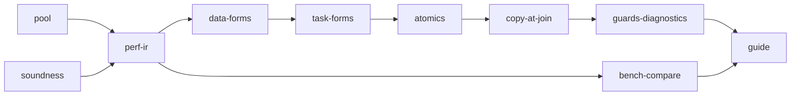

# Threads to completion

## Context

[`nish/threads`](../../std/threads.ts) ships P1 (`parallelMapInto`, `parallelReduce`), P2 (`using s = scope()`), and P3 (`Mutex<T>`, `Channel<T>` of scalars) — [wp29](../../docs/wp29-thread-surface.md). Data races are rejected at compile time; 3.89x on four cores for the histogram. What stands between this and "complete":

- **Performance.** Every region and every join calls `pthread_create`/`pthread_join` ([runtime-parallel.c:153-164, 254-265](../../runtime/runtime-parallel.c)), ~125 µs per four-way region (wp20 §8e), so `REGION_COST = 2^22` ([parallel.ts:652](../../src/parallel.ts)) keeps mid-sized work sequential. The lock spins and `sched_yield`s instead of sleeping. `nish_cpu_count` ignores affinity and cgroup quotas.
- **Ease.** Arrows capture nothing, so `parallelMapInto(src, dst, (x) => x * k)` with a local `k` is refused. Every task needs a throwaway `const done: i32[]` destination and a single-argument class. No `parallelMap` returning an array, no index form. The common refusals explain why but not what to write.
- **Power.** Results, channel elements and guarded stores are scalars only. No atomics. No random numbers in parallel code. A guard cannot go to a helper. A task's own scratch array (a sieve, a DP table) is likely refused as a shared write.
- **Soundness.** [#564](https://github.com/amritk/nish/issues/564): a scope's region-write check ignores `new`. [#567](https://github.com/amritk/nish/issues/567): NL2479 refuses harmless reads.

## Approach

Keep wp29's posture — the compiler proves race freedom, nothing detached, no `Send`/`Sync` — and remove the friction around it. The deliberate choices:

- **Capture without closures.** Parallel arrows and arrow tasks may read the enclosing function's `const` locals. The capture is packed into the region or task context the runtime already passes, and every scope rule treats a captured binding exactly as it treats the task argument. A general closure feature stays out of scope.
- **The pool is FIFO, and the joining thread helps.** C6's no-deadlock argument rests on tasks running in spawn order when they cannot start on a thread of their own. A FIFO queue the joiner drains in order keeps that true for any pool size, zero workers included. Work stealing is declined because a LIFO deque breaks it.
- **Thread count is an environment variable, not syntax.** `NISH_NUM_THREADS` as a knob, not `scope(n)`.
- **Atomics now.** wp29 §9 deferred them until real programs needed them; the per-value-lock histogram ran slower than one thread, which is that evidence.
- **Copy-at-join for `string` and scalar arrays only.** Class values and nested arrays stay refused, pinned by negatives.

Stage order: `pool` and `soundness` run concurrently (runtime-only vs checker-only). Every other `src/` stage is sequential, because each one regenerates `tests/self/goldens/checked*.txt` and shares `src/parallel.ts`. `bench-compare` develops beside the `src/` chain once `perf-ir` has merged. `guide` is last.



## Every stage

- The seed must match `main`: run `bash scripts/fetch-seed.sh --force` before building.
- A `src/` stage meets CLAUDE.md's definition of done for each construct:
  - a golden `.ll` and an `llvm-as` pass;
  - a native round trip with expected stdout, plus Node parity;
  - at least one negative test, and its sibling escape routes;
  - the `docs/LANGUAGE.md` rule and its `docs/IR_COOKBOOK.md` entry;
  - the exact IR in the PR body.
- Goldens are regenerated, never hand-edited: `node tests/self/goldens.js --update`, and `node tests/differential/goldens.js --update` for a new positive case.
- New diagnostic codes take the next free number in their band in `src/codes.ts`.
- The `wasi` section skips without a sysroot. Install `wasi-libc` (`sudo apt-get install -y wasi-libc`) and run it with `WASI_SYSROOT=/usr`, then read the skip line.
- The commit subject and body are the changelog entry. A `perf` or `feat` claim carries `Measured:` with the noise band.

## Pool

**Owns:** `runtime/runtime-parallel.c`, `runtime/nish.h`, `tests/runtime-test.c`, `tests/run.js`, `bench/par-regions.ts`, `bench/run.mjs`, `docs/BENCHMARKS.md`, `docs/wp20-threads.md`

- Measure `bench/par-regions.ts` on `main` first. It is a 2^17-element map called 1,000 times, with the input changed on every call and folded into a printed checksum.
- **The pool.**
  - Workers start on the first divided region or join and park on a futex or condvar.
  - A region or join enqueues jobs FIFO, and the joining thread takes jobs in order until the queue drains.
  - The pool is sized `nish_cpu_count() - 1`, capped at `NISH_PAR_MAX`.
  - `nish_par_depth` stays 1 in workers, so nested regions stay sequential.
  - N-API async builds keep today's create/join, because parked threads must not outlive an unloaded addon.
- **The arena.** A worker rewinds its thread-local arena after each job (`nish_reset_arena`, [runtime.c:131](../../runtime/runtime.c)) and keeps at most one chunk.
- **Core count.** `nish_cpu_count` takes the minimum of three numbers, cached as today:
  - `sched_getaffinity`;
  - the cgroup v2 `cpu.max` quota;
  - `NISH_NUM_THREADS` when it is set and positive.
- **Ceilings.** The two `runtime-parallel.c` ceilings in `tests/run.js` move to the new measured sizes, with the figures in the comment.
- Done when `par-regions` is measurably faster than on `main`, outside the noise band, and every existing threads round trip prints the same.

## Soundness

**Owns:** `src/parallel.ts`, `src/attributes.ts`, `src/escape.ts`, `src/codes.ts`, `tests/cases/**`, `tests/self/goldens/**`, `tests/differential/**`, `docs/LANGUAGE.md`, `docs/IR_COOKBOOK.md`

- **#564.** `walkRegion` hands only `N_CALL` to `regionCallMessage` ([parallel.ts:1451,1481](../../src/parallel.ts)). Route `N_NEW` through it too. `Fixes #564`.
- **#567.** Reads of `this`'s own fields in a channel-holding constructor are admitted. Writes, and `this` leaving the constructor, stay refused. `Fixes #567`.
- **Private writes.** Probe first: a task that fills a local `new Array<i32>(n)`. If it is refused, stop counting stores into the function's own fresh, non-escaping allocation as `sharedWrite`, and compose `writesThrough` per parameter so handing that local to a helper does not taint the caller. If the probe passes already, pin it with a positive case and say so.
- **Escape routes.** For every rule touched, add a negative case for each of CLAUDE.md's three routes:
  - `new`, since a constructor is a call;
  - every declarator of a `using` statement;
  - `this` leaving a constructor.

## Perf IR

**Owns:** `src/emit-parallel.ts`, `src/runtime.ts`, `src/parallel.ts`, `runtime/runtime-parallel.c`, `runtime/nish.h`, `tests/**`, `docs/LANGUAGE.md`, `docs/IR_COOKBOOK.md`, `docs/BENCHMARKS.md`, `docs/wp29-thread-surface.md`

- **Futex mutex.** The lock word gets a third state, "held with waiters":
  - The release is an `atomicrmw xchg`, and it calls `nish_mutex_wake` when the old value was "waiters".
  - `nish_mutex_wait` spins briefly, then sleeps with `futex` (Linux) or `__ulock_wait` (Darwin).
  - Measure a per-value-lock histogram with eight tasks on four cores, before and after.
- **Grain.** Retune `REGION_COST` from `par-regions`, and state the new crossover in LANGUAGE.md. This stage owns every golden the change moves.
- **Knob.** LANGUAGE.md states `NISH_NUM_THREADS` and the affinity rule.

## Data forms

**Owns:** `std/threads.ts`, `src/**`, `tests/**`, `examples/**`, `docs/LANGUAGE.md`, `docs/IR_COOKBOOK.md`, `docs/wp29-thread-surface.md`

```ts
const ys = parallelMap(xs, (x) => x * k + b);         // k, b: const locals
const sq = parallelFrom(n, (i) => f(i));             // like Array.from({ length: n }, ...)
parallelMapInto(xs, dst, (x) => table[x & 7] * k);    // table: a const local array, read-only
```

- `parallelMap` and `parallelFrom` allocate the result in the parent before the region, then run P1's intrinsic. P1's purity and destination-reachability rules apply unchanged.
- **Capture.**
  - An arrow passed to any P1 form (`parallelMap`, `parallelFrom`, `parallelMapInto`, `parallelReduce`) may read `const` locals of the enclosing function.
  - Scalars are copied into the region context. References are read-only: a write through one is a shared write and is refused.
  - A captured value that reaches `dst` is refused, as an argument is today.
  - A captured `let` is refused, with a message that says to bind a `const`.

## Task forms

**Owns:** `std/threads.ts`, `std/random.ts`, `std/README.md`, `src/**`, `tests/**`, `examples/**`, `docs/LANGUAGE.md`, `docs/IR_COOKBOOK.md`, `docs/wp29-thread-surface.md`

```ts
{
  using s = scope();
  s.spawn(() => binInto(xs0, hist));   // captures const locals; returns void; no destination
  s.spawn(() => binInto(xs1, hist));
}
```

- **Arrow entries.**
  - An arrow entry's captured `const` locals are the task's arguments for every rule: R7, R8, C2, C4, C5, C6, the parent's region rule and #564's `new`.
  - The task's thread is named after the enclosing function and spawn index, so a debugger still shows a name.
- **No destination.** `s.spawn(entry, arg)` and `s.spawn(() => ...)` are accepted when the entry returns `void`. The four-argument form stays for a scalar result.
- **`Rng`.** `std/random.ts` exports `class Rng { constructor(seed: i32); nextI32(): i32; nextF64(): f64 }`, a xorshift or PCG over 32-bit state, so Node gives the same bits. An `Rng` the body or task constructs itself is private, which depends on `soundness`'s private-write rule.

## Atomics

**Owns:** `std/threads.ts`, `src/**`, `runtime/**`, `tests/**`, `examples/**`, `docs/LANGUAGE.md`, `docs/IR_COOKBOOK.md`, `docs/wp29-thread-surface.md`

- **Surface.** `AtomicI32` and `AtomicI64` provide `load`, `store`, `add`, `sub`, `min`, `max` and `compareExchange`.
- **Lowering.** `seq_cst` `atomicrmw` and `cmpxchg` on a field. Under Node they are plain operations.
- **Reachability.** Atomics follow `Mutex`'s rules:
  - fresh at construction (R1);
  - reaching a task only as or through its argument or a capture (R8);
  - not touched by the parent inside the scope block (R7).
- **Parallel bodies.** An atomic operation is the one shared write a P1 body may make. Its result is deterministic only for commutative updates, which is the author's obligation, as for the lock.
- **Measurement.** `examples/histogram-atomic.ts` is measured against the lock version and one thread, under the root `Measured:` discipline.

## Copy at join

**Owns:** `std/threads.ts`, `src/**`, `runtime/**`, `tests/**`, `docs/LANGUAGE.md`, `docs/IR_COOKBOOK.md`, `docs/wp29-thread-surface.md`

- **The copy.**
  - A worker copies a `string` or scalar-element array answer into a malloc'd transfer buffer before its arena rewinds.
  - The parent copies the buffer into its own arena in the task's `finish` and frees it.
  - A channel's buffer already lives outside every arena, so a `Channel<string>` send copies in and the receive copies out.
  - A string stored through a guard (R4) is copied into memory the mutex owns.
- **Widened rules.** C1 and R4 widen to `string`. Results widen to `string` and scalar arrays.
- **Negatives.** Class values and nested arrays stay refused, each with a negative golden run after `churn()` (CLAUDE.md, #520).

## Guards and diagnostics

**Owns:** `src/**`, `tests/**`, `docs/LANGUAGE.md`, `docs/IR_COOKBOOK.md`, `docs/wp29-thread-surface.md`

- **Guard helpers.** A guard may be passed to a function when `src/escape.ts` proves the parameter does not escape and is used only as R3 allows. Every other R3 refusal stands.
- **Diagnostics.** The ten thread diagnostics that newcomers are likeliest to hit each end with the code to write instead, modelled on the task-arrow message ([parallel.ts:805](../../src/parallel.ts)):
  - arrow capture;
  - a non-scalar result;
  - the destination rule;
  - NL2471, which must stop recommending a `Mutex` for private scratch;
  - R1, R3, C2, C5, C6 and R7.

  The new wordings are pinned in `tests/wordings`.
- **`--fix`** rewrites the mechanical refusals in `src/fix.ts`.

## Benchmarks

**Owns:** `bench/par-*.rs`, `bench/par-*.go`, `bench/par-*.ts`, `bench/par-*.c`, `bench/run.mjs`, `bench/README.md`, `docs/BENCHMARKS.md`

- Port `par-compute`, `par-nbody`, `par-regions` and the histogram to Rust (`std::thread::scope`, and Rayon where it builds) and to Go (goroutines plus `sync.WaitGroup`). Nish's own `.ts` kernels may only be edited in their bench copies.
- Report minimums and medians over at least eleven interleaved rounds, with the noise band.
- State Nish over the fastest other language per kernel, and say plainly where Nish loses.

## Guide

**Owns:** `docs/guide/language/concurrency.md`, `scalar.config.json`, `docs/AI.md`, `README.md`, `docs/wp29-thread-surface.md`, `docs/MASTER_PLAN.md`

- Merges after the user-guide run's `foundation` stage ([#570](https://github.com/amritk/nish/issues/570)), which creates `docs/guide/`.
- **The page.**
  - It opens with the which-tool table:

    | need | tool |
    | --- | --- |
    | same work on every element | `parallelMap` |
    | a fold | `parallelReduce` |
    | unlike jobs | `scope` |
    | shared counter | `AtomicI32` |
    | shared structure | `Mutex` |
    | pipeline | `Channel` |

  - Then one short compiled example each, and what the compiler refuses and why, in a paragraph.
  - It links the LANGUAGE.md sections, and links no `wp*.md`.
- **Status.** `docs/AI.md`'s threads rules and README's blurb match the finished surface. WP29 is marked complete, with the declined list.

## Out of scope

- **Kept declined:**
  - detached `go`-style spawn and `Arc`;
  - `select`;
  - bounded channels, which block forever under Node;
  - `scope(n)` syntax;
  - general closure capture outside parallel forms and tasks;
  - wasm threads, since tasks already run correctly in sequence there;
  - work stealing and nested parallel regions.
- **Deferred to a later run:** `parallelSort` and `parallelFilter`, and copy-at-join for class values.

## Verification

Each stage's `verification` line, run bare and read for its exit status and skip count. `npm test` must be undegraded.
