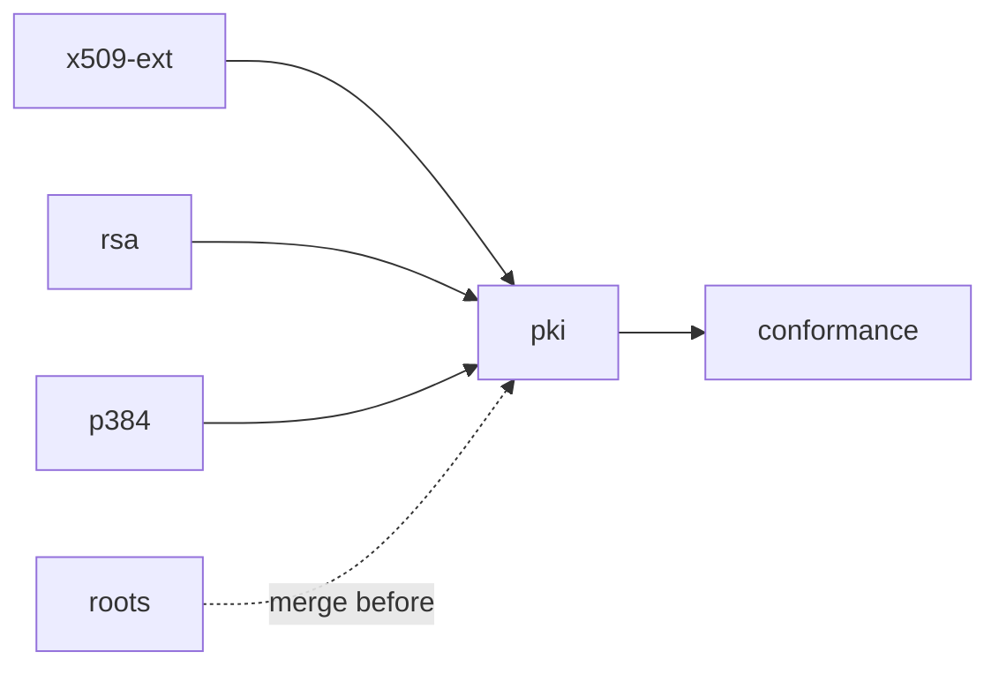

# Certificate-chain validation for a TLS client

## Context

What exists today (survey at `3e15e91`):

- [`std/crypto/x509.ts`](../../std/crypto/x509.ts) parses certificates strictly but reads no extension; it knows only ecdsa-with-SHA256 and P-256 keys (`p256`, `ecdsaSha256` booleans); `x509VerifySignature` checks one link under P-256 and says it is not path validation (`docs/security/crypto-x509.md` X509-5).
- There is **no RSA, no P-384 and no big-integer code** anywhere in the repo. The request names "the RSA/P-384 work"; it does not exist on `main`, on a branch or in an open PR, so this plan builds it (stages `rsa`, `p384`).
- There is **no TLS client** in `std/` (the stack is server-side, `std/net/tls.ts`). This plan delivers the validator as a library a client calls with the chain it received; wiring it into a client handshake is out of scope because there is no client to wire it into.
- `nish:fs` (`readFileSyncOrNull`, `readdirSync`, `isDirectorySync`) and `nish:process` (`getenv`) are what root loading needs; `Date.now()` is the clock, refused on wasm32, so `pki` takes `nowMs: i64` as an argument and only `pki-roots` is native-only.
- SHA-256/384/512 (`crypto/sha256.ts`, `crypto/sha512.ts`), P-256 (`crypto/p256.ts`) and Ed25519 (`crypto/ed25519.ts`) exist. Wycheproof is already vendored (Apache-2.0, `tests/link/crypto_wycheproof/`), as is fiat-crypto (`std/crypto/LICENSE-fiat-crypto`).

## Approach

- **Six stages, one PR each.** Four run at once (`x509-ext`, `rsa`, `p384`, `roots`): none consumes another's interface. `pki` consumes all four, so it starts when `x509-ext`, `rsa` and `p384` have merged and merges after `roots`. `conformance` starts when `pki` has merged.
- **The interfaces are fixed here**, so the parallel stages agree without talking: each stage's API section is the contract, and a worker that needs to change a signature says so in its PR body rather than doing it.
- **Verification only.** Nothing here signs or holds a private key, so RSA and P-384 are variable-time over public inputs and need no `Secret`. Each record says so.
- **Where RFC 5280 leaves a choice, follow x509-limbo's expected result** for server validation (the `webpki`-style profile), and record the choice. Every decision below that limbo might contradict is marked *(limbo decides)*; `conformance` reconciles them.
- **Fail closed.** An extension, name-constraint form, algorithm or parameter the code does not understand rejects the chain; it is never skipped.

### Shared registry files: the one exception to disjoint ownership

Adding a `std/` module touches the same registries in every stage: `src/std-modules.ts` (one string literal), the module lists in `tests/run.js`, `std/README.md`, `docs/LANGUAGE.md`'s `nish/crypto/<primitive>` bullet (around :2167 and :2212), `docs/guide/using-nish/standard-library.md`'s `nish/crypto` table, `docs/security/README.md`'s Areas table, and `THIRD_PARTY_NOTICES.md`. Splitting them out would serialise the whole run for one-line edits. So every stage **may append its own rows** to these files and nothing else in them, and the textual conflicts that follow are resolved by the worker when it is told it is next to merge (it merges `main` then anyway). Generated files, `tests/self/goldens/checked/**` and `tests/differential/**`, are regenerated by every stage, never hand-merged. Editing someone else's row in a registry file is a scope finding.

`src/std-modules.ts` is in `src/`, so every stage that adds a module also runs `node tests/run.js wasi` (with `WASI_SYSROOT=/usr`) and `node tests/run.js performance` before pushing, as `CLAUDE.md` requires. A string literal is not a new construct, so the rolling freeze is not in play.

### Merge order

`x509-ext`, `rsa`, `p384`, `roots` in whichever order they converge, then `pki`, then `conformance`.



## x509-ext

**Owns:** `std/crypto/x509.ts`, `tests/link/crypto_x509/**`, `tests/link/crypto_x509_audit/**`, `tests/link/crypto_x509_malformed/**`, `tests/link/crypto_x509_f64/**`, `tests/fuzz/targets/x509-*.ts`, `tests/fuzz/corpus/x509-*/**`, `docs/security/crypto-x509.md`, plus its own rows in the shared registry files and the regenerated goldens.

### Algorithms and keys

New fields on `X509Certificate`; the existing `p256` and `ecdsaSha256` booleans stay, meaning what they mean now.

```ts
export const X509_SIG_UNKNOWN: i32 = 0
export const X509_SIG_ECDSA_SHA256: i32 = 1
export const X509_SIG_ECDSA_SHA384: i32 = 2
export const X509_SIG_RSA_PKCS1_SHA256: i32 = 3   // also _SHA384 = 4, _SHA512 = 5
export const X509_SIG_RSA_PSS: i32 = 6            // hash in pssHash, salt in pssSaltLen
export const X509_SIG_ED25519: i32 = 7
export const X509_SIG_RSA_PKCS1_SHA1: i32 = 8     // recognised so pki can refuse it by name
export const X509_KEY_UNKNOWN: i32 = 0            // _P256 = 1, _P384 = 2, _RSA = 3, _ED25519 = 4
export const X509_HASH_SHA256: i32 = 1            // _SHA384 = 2, _SHA512 = 3; the ids rsa.ts uses too
// on X509Certificate: version: i32, sigAlg: i32, pssHash: i32, pssSaltLen: i32, keyType: i32
```

`x509DerSignatureRSWidth(sig: u8[], width: i32): u8[] | null` is `x509DerSignatureRS` for halves of `width` bytes (32 or 48); the existing function becomes its 32-byte call, unchanged in behaviour.

RSASSA-PSS parameters (RFC 4055) are accepted only when the MGF is MGF1 with the same hash as the message hash and the trailer field is 1; anything else is `X509_SIG_UNKNOWN`, which `pki` refuses. ECDSA and Ed25519 algorithm identifiers must have absent parameters; PKCS#1 ones NULL. `publicKey` stays the BIT STRING octets (for RSA, the `RSAPublicKey` DER `rsa.ts` reads). Unknown algorithms still parse — `sigAlg` says unknown — so a store of roots with exotic keys loads.

### Extensions

Read in `x509ParseCertificate` (v3 only; an extensions field on v1/v2 already refuses). A duplicate extension OID, or a malformed value of an extension this module decodes, answers `null` (RFC 5280 §4.2).

```ts
export class X509GeneralSubtree { kind: i32; dns: string; ip: u8[]; mask: u8[]; dirName: u8[] }  // X509_GN_DNS/_IP/_DIR/_OTHER
// on X509Certificate:
//   sanDns: string[], sanIp: u8[][], sanPresent: boolean, sanOther: i32 (count of other forms)
//   bcPresent: boolean, bcCa: boolean, bcPathLen: i32 (-1 when absent)
//   keyUsage: i32 (bit mask, bit 0 = digitalSignature … bit 5 = keyCertSign; -1 when absent)
//   ekuPresent: boolean, ekuServerAuth: boolean, ekuAny: boolean
//   ncPresent: boolean, ncPermitted: X509GeneralSubtree[], ncExcluded: X509GeneralSubtree[], ncUnsupported: boolean
//   skid: u8[] | null, akid: u8[] | null
//   unknownCritical: boolean   // a critical extension this module does not decode
```

Decoded: subjectAltName, basicConstraints, keyUsage, extKeyUsage, nameConstraints, subjectKeyIdentifier, authorityKeyIdentifier (keyIdentifier only). Recognised but not decoded, so a critical one is not "unknown": none — certificatePolicies, policyConstraints, inhibitAnyPolicy and the rest count as unknown when critical, which is fail-closed and *(limbo decides)* whether policy extensions need decoding. `sanDns` keeps the IA5String bytes as ASCII exactly (no case folding here); a non-IA5 byte refuses the certificate.

### Names

`x509NameEqual(a: u8[], b: u8[]): boolean` compares two Name DERs for issuer-subject chaining. Byte equality, as webpki and Go do, is the rule *(limbo decides)*; RFC 5280 §7.1's case-folding comparison is recorded as not implemented. `x509NameIsPrefix(base, name)` serves directoryName constraints.

### Tests

Fixtures made with `openssl` (commands in the fixture header, as `tests/link/crypto_x509/fixtures.ts` does now): an RSA-2048 PKCS#1 and an RSA-PSS leaf, a P-384 CA, an Ed25519 leaf, and a leaf carrying every decoded extension. One negative per refusal: duplicate extension, malformed SAN, basicConstraints with a negative pathLen, PSS with mismatched MGF hash, a non-IA5 dNSName. Every existing check stays green unchanged — the P-256 path must parse to the same fields as before.

### Docs

`docs/security/crypto-x509.md`: the scope rows for the new functions, X509-5 narrowed to "parses, `crypto/pki` validates", new findings for anything the review finds. `std/README.md` row, `docs/LANGUAGE.md` x509 bullet, and the `nish/crypto/x509` row in the standard-library guide page.

## rsa

**Owns:** `std/crypto/rsa.ts`, `tests/link/crypto_rsa/**`, `tests/link/crypto_wycheproof_rsa/**`, `docs/security/crypto-rsa.md`, plus its own registry rows and regenerated goldens.

### Arithmetic

Big integers as little-endian `u32` limbs (or what the existing curve code uses), Montgomery multiplication, square-and-multiply over the public exponent. Variable-time is correct here: modulus, exponent, signature and message are all public. Modulus 1024 to 8192 bits in the module (Wycheproof has 1024-bit vectors); `pki` imposes the 2048-bit floor. No algorithm is copied: if one is ported (BearSSL's `i31` is the natural candidate), follow `.claude/licensing.md`.

### API

```ts
export class RsaPublicKey { n: u8[]; e: u8[]; bits: i32 }   // big-endian, minimal
export const rsaParsePublicKey = (der: u8[]): RsaPublicKey | null        // PKCS#1 RSAPublicKey; e odd, 3 <= e < n
export const rsaVerifyPkcs1v15 = (key: RsaPublicKey, hash: i32, msg: u8[], sig: u8[]): boolean
export const rsaVerifyPss = (key: RsaPublicKey, hash: i32, saltLen: i32, msg: u8[], sig: u8[]): boolean  // MGF1 with the same hash
```

`hash` takes x509's `X509_HASH_*` values (re-declared here, not imported, so rsa does not depend on x509). PKCS#1 v1.5 builds the expected encoding (`00 01 FF… 00 DigestInfo`) and compares it whole, never parses the decrypted block (Bleichenbacher '06). The signature must be exactly `k` bytes and `< n`. PSS follows RFC 8017 §9.1.2 to the letter, including the leftmost-bits and `0x01` separator checks.

### Tests

Wycheproof `rsa_signature_{2048,3072,4096}_sha{256,384,512}_test.json` and `rsa_pss_*_mgf1_*_test.json` at the commit already pinned (`3fa63dd`), generated into Nish source like `tests/link/crypto_wycheproof/ecdsa_secp256r1_sha256.ts`, each case checked against its `valid`/`invalid` result (`acceptable` recorded as which way the module goes). Plus `tests/link/crypto_rsa` for parse refusals (even e, e=1, n with a leading zero, sig longer than n).

### Docs

`docs/security/crypto-rsa.md` (scope, threat model — public inputs only, what a malformed key or signature does, the variable-time note), Areas row, `std/README.md`, LANGUAGE.md bullet, guide row, `THIRD_PARTY_NOTICES.md` row for the Wycheproof files.

## p384

**Owns:** `std/crypto/p384.ts`, `tests/link/crypto_p384/**`, `tests/link/crypto_wycheproof_p384/**`, `docs/security/crypto-p384.md`, plus its own registry rows and regenerated goldens.

### Arithmetic

Port fiat-crypto's `p384_64` field (and scalar arithmetic for `n`) the way `crypto/p256.ts` ported P-256's, keeping its notice. Point arithmetic: complete formulas (Renes–Costello–Batina) as P-256 uses, if it does.

### API

```ts
export const p384Verify = (pub: u8[], digest: u8[], sig: u8[]): boolean      // pub: 97-byte uncompressed SEC1; sig: r || s, 48 bytes each
export const p384VerifySha384 = (pub: u8[], msg: u8[], sig: u8[]): boolean
```

A digest longer than 48 bytes is truncated per SEC 1 §4.1.4; a point off the curve, the identity, `r` or `s` out of `[1, n)` answer `false`. `x509DerSignatureRS` hard-codes 32-byte halves (`x509.ts:520`); `x509-ext` adds the width-taking form `pki` uses, so `p384` must not edit `x509.ts` — its DER Wycheproof vectors are converted by a helper in its own test directory.

### Tests

Wycheproof `ecdsa_secp384r1_sha384_test.json`, `_sha384_p1363_test.json`, `ecdsa_secp384r1_sha256_test.json` (and `_sha512` if present at the pin), generated like P-256's.

### Docs

`docs/security/crypto-p384.md`, Areas row, `std/README.md`, LANGUAGE.md bullet, guide row, `THIRD_PARTY_NOTICES.md` rows (fiat-crypto file, Wycheproof files).

## roots

**Owns:** `std/crypto/pki-roots.ts`, `tests/link/crypto_pki_roots/**`, `tests/link/crypto_pki_roots_wasm/**`, `docs/security/crypto-pki.md` (created here, with only the `pki-roots.ts` scope row and the roots sections), plus its own registry rows and regenerated goldens.

### Lookup order

```ts
export class PkiRoots { roots: X509Certificate[]; sources: string[]; skipped: i32 }
export const PKI_SYSTEM_BUNDLES: string[]  // in order, below
export const pkiLoadRoots = (file: string | null, dirs: string[], bundles: string[]): PkiRoots
export const pkiLoadSystemRoots = (): PkiRoots  // reads SSL_CERT_FILE / SSL_CERT_DIR, then the defaults
```

1. If `SSL_CERT_FILE` or `SSL_CERT_DIR` is set and non-empty, use exactly those: the file, and each directory of the `:`-separated list. No fallback to the defaults — the variables override, as in OpenSSL and Go.
2. Otherwise the first of these files that exists: `/etc/ssl/certs/ca-certificates.crt` (Debian, Ubuntu, Arch, Gentoo), `/etc/pki/tls/certs/ca-bundle.crt` (Fedora, RHEL), `/etc/ssl/ca-bundle.pem` (openSUSE), `/etc/pki/tls/cacert.pem` (OpenELEC), `/etc/pki/ca-trust/extracted/pem/tls-ca-bundle.pem` (CentOS/RHEL 7), `/etc/ssl/cert.pem` (Alpine, macOS, the BSDs); then the directory `/etc/ssl/certs`. The list is facts about distributions, cited from Go's `crypto/x509/root_linux.go`, not copied code.
3. A directory contributes every regular file whose name ends `.pem` or `.crt` or matches OpenSSL's `xxxxxxxx.N` hash form.

A file is split into PEM blocks here (not through `pemToDer`, which refuses the whole file for one bad block); each `CERTIFICATE` block that `x509ParseCertificate` accepts is a root, every other block is counted in `skipped`. Duplicates (same DER) are dropped. Nothing found is an empty `roots`, never an exit. File reads are bounded by `nish:fs`'s size limit.

### Tests

`tests/link/crypto_pki_roots` with an `args`/`.env`-driven fixture tree: the file variable wins over the dir; the dir alone; a bundle with a malformed block and a `TRUSTED CERTIFICATE` block (skipped, counted); a missing path; duplicates. `pkiLoadRoots` with an explicit bundle list covers the default order without touching the host's `/etc`. A wasm32 build importing `pki-roots` is refused (as `crypto_x509_random_wasm` does), and a wasm32 build importing `pki` alone compiles once `pki` exists — that second half is `pki`'s.

### Docs

`docs/security/crypto-pki.md` sections: the roots threat model (an attacker who controls the environment controls trust — documented, not defended), the skip rule, the lookup order, and **what this misses compared with the macOS Keychain**: roots an admin or MDM profile installed, per-user and admin trust settings (including roots marked never-trust), Apple's partial distrust and per-root constraints (e.g. dates after which a CA's leaves are refused), and the Keychain's revocation and CT policy — `/etc/ssl/cert.pem` is a static snapshot updated only by OS updates. Areas row, `std/README.md` (native only), LANGUAGE.md bullet, guide row.

## pki

**Owns:** `std/crypto/pki.ts`, `tests/link/crypto_pki/**`, `docs/security/crypto-pki.md` (adds the `pki.ts` scope and validation sections to what `roots` created), `docs/guide/using-nish/tls-certificates.md`, `scalar.config.json`, plus its own registry rows and regenerated goldens.

```ts
export const PKI_OK: i32 = 0
// PKI_ERR_MALFORMED, _EXPIRED, _NOT_YET_VALID, _UNTRUSTED, _BAD_SIGNATURE, _NOT_CA, _PATH_LENGTH,
// _KEY_USAGE, _EXT_KEY_USAGE, _UNKNOWN_CRITICAL, _NAME_CONSTRAINTS, _HOSTNAME, _WEAK_KEY,
// _UNSUPPORTED_ALGORITHM, _CHAIN_TOO_LONG, _BUDGET
export class PkiTrustStore { /* roots indexed by subject DER */ }
export class PkiResult { code: i32; path: X509Certificate[] }   // leaf first, anchor last when PKI_OK
export const pkiTrustStore = (roots: X509Certificate[]): PkiTrustStore
export const pkiVerifyServer = (chain: u8[][], hostname: string, nowMs: i64, store: PkiTrustStore): PkiResult
export const pkiMatchHostname = (leaf: X509Certificate, hostname: string): boolean
export const pkiVerifySignature = (cert: X509Certificate, issuer: X509Certificate): boolean
export const pkiReason = (code: i32): string
```

### Signatures

`pkiVerifySignature` dispatches on `cert.sigAlg` and `issuer.keyType`: ECDSA-SHA256/384 under P-256 or P-384 (either hash under either curve), RSA PKCS#1 SHA-256/384/512, RSA-PSS with the parameters `x509-ext` accepted, Ed25519. SHA-1, an unknown algorithm or a key/algorithm mismatch refuses (`_UNSUPPORTED_ALGORITHM`); an RSA key under 2048 bits refuses (`_WEAK_KEY`).

### Path building

The chain's first certificate is the leaf; the rest are an unordered pool of possible intermediates (servers send them out of order and with extras). Depth-first search from the leaf: candidate issuers are pool certificates and store roots whose subject equals the child's issuer (`x509NameEqual`), filtered by AKI/SKI when both are present, store roots first. A certificate never appears twice in a path. Bounds, each a named constant with its reason in the record: at most 8 certificates in a path (`_CHAIN_TOO_LONG`), at most 64 signature checks per call (`_BUDGET`) — a hostile chain of many same-named intermediates must not cost exponential time. A path ends at a store root (the trust anchor: name and key, per RFC 5280 §6.1.1; its own signature, validity and extensions are *(limbo decides)* — start with not checked). When every path fails, answer the reason from the path that got closest to an anchor, deterministically.

### Path validation

Along a candidate path, per RFC 5280 §6.1, with `nowMs` from the caller:

- every certificate: `notBefore <= now <= notAfter`; `unknownCritical` refuses; signature verifies under its issuer.
- every issuer (intermediate or anchor used as issuer): v3 with `bcCa` true (`_NOT_CA`); `bcPathLen`, when set, at least the number of non-self-issued intermediates below it (`_PATH_LENGTH`); `keyUsage`, when present, includes keyCertSign (`_KEY_USAGE`); `extKeyUsage`, when present, includes serverAuth (EKU chaining, as Mozilla and Go do; `_EXT_KEY_USAGE`).
- the leaf: `keyUsage`, when present, includes digitalSignature; `extKeyUsage`, when present, includes serverAuth (anyExtendedKeyUsage alone does not count *(limbo decides)*); a CA leaf *(limbo decides)*.
- name constraints from every issuer above apply to every certificate below: dNSName subtrees to SAN dNSNames (and to the hostname), iPAddress subtrees to SAN iPAddresses, directoryName subtrees to the subject (non-self-issued). Permitted is an intersection, excluded a union. A subtree of any other form (`ncUnsupported`) refuses the chain (fail closed).

### Hostname

RFC 6125 §6, never the subject CN:

- The hostname is ASCII (a caller converts an IDN to A-labels first); compared case-insensitively; one trailing dot stripped from both sides; empty labels refuse.
- An IPv4 dotted quad or an IPv6 literal (with or without brackets) matches only SAN iPAddress entries, by bytes; it never matches a dNSName, wildcard or not.
- Otherwise only SAN dNSName entries match. A wildcard is accepted only as the whole leftmost label (`*.example.com`), followed by at least two labels; it matches exactly one non-empty label. `f*.example.com`, `*.*.example.com`, `www.*.com` and `*.com` never match.
- No SAN, or a SAN with neither form, is `_HOSTNAME`.

### Tests

`tests/link/crypto_pki`: chains built with `openssl` (commands in the fixture header) and validated at a fixed `nowMs` so the test never ages. An accepting RSA leaf → RSA intermediate → RSA root, and an ECDSA P-256 leaf → P-384 intermediate → P-384 root; chain sent out of order and with an extra unrelated cert. One refusal each, asserting its reason code: expired, not yet valid, wrong host, a CN-only cert for the right host, root not in the store, intermediate signed by the wrong key, intermediate with CA:false, pathLen exceeded, intermediate without keyCertSign, EKU clientAuth only, unknown critical extension, excluded and non-permitted dNSName, unsupported name-constraint form, 1024-bit RSA, SHA-1 signature, a loop of cross-signed intermediates and a 100-intermediate same-name chain hitting the budget. Hostname table tests for every rule above. Every refusal's test must fail with its check removed — say in the PR how that was checked.

### Docs

`docs/security/crypto-pki.md` completed: scope (`pki.ts`), threat model (a network attacker chooses the whole chain), the bounds, every *(limbo decides)* choice as made, what is not done (revocation — no CRL, OCSP or CT; policy processing; RFC 5280 §7.1 name folding; trust-anchor constraints) as open Low/Medium findings. `docs/guide/using-nish/tls-certificates.md` (new topic, route in `scalar.config.json`): verifying a server chain, loading roots, the reason codes, what is not checked, macOS. LANGUAGE.md bullet, `std/README.md` row, guide row; a wasm32 build importing `pki` without `pki-roots` compiles (a `tests/run.js` check).

## conformance

**Owns:** `tests/link/crypto_pki_limbo/**`, `tests/link/crypto_pki_limbo/LICENSE-x509-limbo`, `docs/security/crypto-pki.md` (divergence findings only), `std/crypto/pki.ts` (fixes a divergence needs, each with its limbo case as the test), plus its `THIRD_PARTY_NOTICES.md` row.

### Generator

x509-limbo (C2SP, Apache-2.0) publishes `limbo.json`. Pin a commit; a Node generator (in the test directory, run by hand, documented in its header) selects testcases whose `validation_kind` is `SERVER` and whose features `pki` claims (no CRLs, no `max_chain_depth` other than default, no client-auth), and writes Nish source: the PEM peer chain, trusted certs, untrusted intermediates, expected peer name, validation time, expected result. That set includes limbo's `bettertls::` name-constraint cases and its `online::` real-world chains. Generated files are excluded from review like the goldens and are regenerated, never edited.

### Runner

`main.ts` runs every case through `pkiTrustStore` and `pkiVerifyServer` and prints one line per case; `expected.out` pins all of them. Divergences (limbo says SUCCESS and we refuse, or the reverse) are listed in one table, each with a decision: fix `pki.ts` in this PR, or keep and record. A divergence where we accept what limbo refuses is fixed or escalated, never kept silently.

### Record

Each kept divergence is a finding in `docs/security/crypto-pki.md` with its limbo id; the pass count is in the record. `THIRD_PARTY_NOTICES.md` row for x509-limbo; `node tests/run.js third-party-licence` green.

## Out of scope

- A TLS client handshake, or wiring `pki` into one — there is no client in `std/`.
- Revocation (CRL, OCSP, OCSP stapling), Certificate Transparency, certificate policies, client-certificate validation, the macOS Keychain or Windows store APIs.
- RSA or P-384 signing, key generation or ECDH.

## Tests

Each stage's `Tests` section. Mirror `tests/link/crypto_x509` (fixtures with their OpenSSL commands, `Suite` from `nish/testing`) and `tests/link/crypto_wycheproof` (generated vectors). New link programs get `_f64` twins where the existing crypto programs have them.

## Verification

Each stage's `verification` field, plus the repository's definition of done: `npm run check`, `npm run lint`, `node tests/run.js <section>` for the sections the stage touches, the `wasi` and `performance` runs for any stage touching `src/`, regenerated goldens (`node tests/self/goldens.js --update`), and CI's four `test` shards green on the head.
