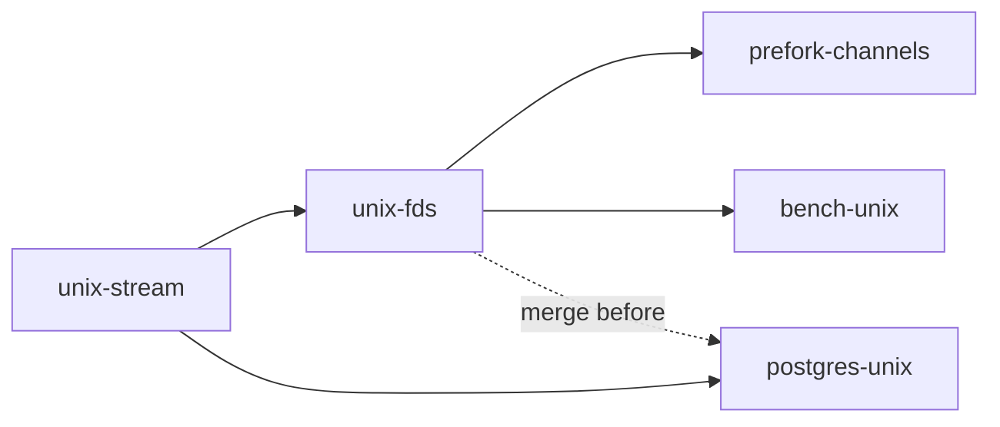

# Unix domain sockets in nish:net

## Context

[`nish:net`](../../docs/LANGUAGE.md) has TCP and UDP only. Its calls are table-driven: an export name and a one-letter-per-parameter signature in [`src/nish-modules.ts`](../../src/nish-modules.ts) (`netSignature`, `netSymbol`), a `declare` in [`src/runtime.ts`](../../src/runtime.ts), and a C function in [`runtime/runtime-net.c`](../../runtime/runtime-net.c). Every call returns an `i32` that is a negative errno on failure (Darwin numbers mapped to Linux by `nish_net_err`). Every socket is non-blocking and close-on-exec. Calls are refused at compile time on wasm (NL2404) and throw under the Node prelude (`runtime/nish.mjs`).

There is no fork in the language. [`std/net/prefork.ts`](../../std/net/prefork.ts) re-executes itself with `spawn`, and every descriptor is close-on-exec, so today no descriptor reaches a worker (RT-17, RT-19). [`std/net/postgres.ts`](../../std/net/postgres.ts) is sans-IO: the connection code lives in the programs that use it, all hard-coded to `127.0.0.1`.

## Approach

- **Every new call follows the existing nish:net contract**: non-blocking, close-on-exec, `i32` result, negative errno, multiple results through caller-allocated out-arrays (the `m`/`w` letters, like `pollWait` and `udpRecvFrom`). No new return types, so no `src/escape.ts` change.
- **Separate names, not overloads of the TCP calls.** `unixAccept(fd)` rather than a generalised `tcpAccept`, because the 18-byte peer address `tcpAccept` writes means nothing for a Unix peer (identity is `peerCredentials`). `unixListenMode` beside `unixListen`, mirroring `tcpListen`/`tcpListenFlags` and `writeFileSync`/`writeFileSyncMode`.
- **Abstract namespace is spelled `@name`**, the notation `ss`, systemd and socat use. A filesystem path starting with `@` is written `./@name`. Darwin refuses `@` with -95.
- **The child's end of a socketpair reaches a worker through `spawnWithFds`**, a `posix_spawn_file_actions_adddup2` per descriptor onto 3, 4, …. The existing spawn machinery already uses that call for stdio. Everything else stays close-on-exec, so RT-17 and RT-19 hold for everything not named.
- **std/ may use the new calls in the same release.** The rolling freeze binds `src/` (and the `std/cli.ts` it imports), which the seed compiles. `std/net/*` is compiled only by the compiler of the same release. CI's `bootstrap` job is the check: if it fails on a std/ use, that stage stops and says so.
- **Two serial src/ stages, then three std/bench stages.** Every builtin edits the same tables, the same C file and the same declaration files, so `unix-stream` and `unix-fds` cannot run concurrently. `unix-stream` is worth merging alone, and folding both into one PR would fail the one-sitting review test.

| stage | starts after | merges after | runs alongside |
| --- | --- | --- | --- |
| unix-stream | — | — | nothing |
| unix-fds | unix-stream merged | unix-stream | postgres-unix |
| postgres-unix | unix-stream merged | unix-fds | unix-fds |
| prefork-channels | unix-fds merged | unix-fds | bench-unix |
| bench-unix | unix-fds merged | postgres-unix | prefork-channels |

`postgres-unix` merges after `unix-fds` only so that the `docs/security/README.md` index row counts are written once, by the stage that owns that file. See its Owns.

**Generated files, never hand-edited or hand-merged, owned by no stage, regenerated by whoever merges `main`:** `tests/self/goldens/checked/**`, `tests/cases/*.ll` (via `UPDATE_GOLDENS=1 node tests/run.js <case>`), `tests/differential/goldens/**` (`node tests/differential/goldens.js --update`), `tests/differential/emit-ts-known.txt` (only under CI's pinned Node), `docs/BENCHMARKS.md`'s generated sections. `tests/shard-costs.json` is not edited: a missing link entry already defaults to its floor.

## Unix stream sockets

**Owns:** `src/nish-modules.ts`, `src/runtime.ts`, `src/builtins.ts`, `src/emit-builtins.ts`, `src/capabilities.ts`, `runtime/runtime-net.c`, `runtime/nish.h`, `runtime/nish.d.ts`, `runtime/nish.mjs`, `runtime/core/host.*`, `tests/runtime-budgets.js`, `tests/runtime-test.c`, `tests/capabilities.js`, `tests/run.js`, `tests/cases/net_unix_*`, `tests/cases/reject_net_unix_*`, `tests/cases/caps_net*`, `tests/link/net_unix_*/**`, `docs/LANGUAGE.md`, `docs/AI.md`, `docs/IR_COOKBOOK.md`, `docs/cookbook/builtin-net-unix*.ts`, `docs/guide/using-nish/unix-sockets.md`, `docs/guide/using-nish/networking.md`, `docs/guide/language/modules.md`, `docs/guide/using-nish/standard-library.md`, `docs/guide/using-nish/sandbox.md`, `scalar.config.json`, `llms.txt`, `docs/security/runtime.md`, `docs/security/sandbox.md`, `docs/security/README.md`, `docs/wp37-os-sandbox.md`

### API

| call | signature letters | result |
| --- | --- | --- |
| `unixListen(path: string, backlog: i32, flags: i32): i32` | `sii` | listening fd, or -errno; socket file mode 0600 |
| `unixListenMode(path: string, backlog: i32, flags: i32, mode: i32): i32` | `siii` | as above with `mode` (0..0o777, else -22) |
| `unixConnect(path: string): i32` | `s` | connected fd, or -errno |
| `unixAccept(fd: i32): i32` | `i` | accepted fd (non-blocking, close-on-exec), -11 when none pending |
| `unixSocketPair(kind: i32, fds: i32[]): i32` | `im` | 0 and `fds[0]`, `fds[1]` set; `kind` 1 stream, 2 seqpacket, else -22; `fds.length < 2` is -22 |

Export option constants beside the calls, like the `NET_*` ids: `NET_UNIX_UNLINK_STALE` = 1, `NET_UNIX_STREAM` = 1, `NET_UNIX_SEQPACKET` = 2. If a new letter or constant kind turns out to be needed, `src/builtins.ts` `checkNet` and `src/emit-builtins.ts` `emitNetCall` are in scope.

### Semantics

- **Path length.** The path plus its NUL must fit `sun_path`: 108 bytes on Linux, 104 on Darwin. Longer is -36 (ENAMETOOLONG) before any syscall, never a truncation. An embedded NUL or an empty path is -22. For `@name`, the name (without `@`) fits in `sizeof(sun_path) - 1` and the address length passed to bind/connect is exact, never padded with the NUL tail.
- **Stale socket file at listen.** By default an existing path is -98 (EADDRINUSE) and nothing is touched. With `NET_UNIX_UNLINK_STALE`, `lstat` the path. If it is not a socket (a regular file, a directory or a symlink to anything), refuse with -17 (EEXIST) and leave it alone. If it is a socket with a live listener (a probe `connect` succeeds or reports EAGAIN), refuse with -98. Only a socket nobody listens on (ECONNREFUSED) is unlinked and the bind retried once. Record the check-then-unlink race in the security record. Abstract names have no file and ignore the flag.
- **Mode.** bind, then `chmod(path, mode)`, then `listen`. Nobody can connect before `listen`, so the window where the file carries the umask's mode admits no one. If `chmod` fails, close and unlink what was bound and return the error. Abstract sockets have no mode: `unixListenMode` with `@` is -22.
- **Connect.** Non-blocking. A Unix connect normally completes at once. If the backlog is full (EAGAIN), close and return -11. If the platform reports in-progress, follow `tcpConnect`'s contract (`connectResult`).
- **socketpair.** `AF_UNIX` with `SOCK_NONBLOCK|SOCK_CLOEXEC` on Linux; `nish_net_setup` on both fds on Darwin. Darwin seqpacket: if `socketpair(AF_UNIX, SOCK_SEQPACKET)` fails with EPROTONOSUPPORT or EPROTOTYPE, return -95.
- **Poll loop.** The fds are ordinary descriptors: `pollAdd`, `pollModify`, `netRead`, `netWrite` (MSG_NOSIGNAL / SO_NOSIGPIPE as today), `netShutdown` and `netClose` work unchanged. Check each in a test rather than assume it.
- **Darwin.** Paths work; `@` is -95; `accept4` is absent (accept, then `nish_net_setup`). No CI runs macOS, so the Darwin branches must at least compile under `clang -target arm64-apple-macos` if the toolchain allows. Say in the PR what was and was not compiled.
- **Error paths close what they opened.** Every fd created inside a call is closed on every failure return, and a bound path is unlinked on a failure after bind.

### Tests

- `tests/cases/net_unix_*`: golden `.ll` for each call, an `llvm-as` pass, and native round trips with expected stdout. Cover listen, connect and accept through `pollWait`, echo, shutdown, seqpacket keeping message boundaries (two writes are two reads of the exact lengths), mode 0600 and a chosen mode read back with the existing stat builtin, and the abstract namespace.
- `tests/cases/reject_net_unix_*`: wrong argument types, a readonly `fds` array, and the wasm refusal (`.args`, like `reject_net_wasm`).
- Runtime refusals with expected stdout: a 108-byte path is -36 and creates no file; the default stale policy is -98; the flag unlinks a stale socket, refuses a regular file with -17 and the file survives, and refuses a live listener with -98; a bad kind or short `fds` is -22.
- `tests/link/net_unix_fd_leaks/`: count entries in `/proc/self/fd` before and after driving every error path above (and a successful open/close cycle); the counts must be equal. Linux only, skipped with a reason elsewhere.
- Under the Node prelude each new name throws like the other net calls (`runCaseUnderPrelude`).
- Existing `tests/cases/net_*.ll` goldens do not change. A program that does not call these sees no difference.

### Docs

The `docs/LANGUAGE.md` `### nish:net` rules (update the "All twenty functions" count), the export table row, the capability row, the sandbox rule and the `--emit-ts` refusal list. A cookbook entry `docs/cookbook/builtin-net-unix.ts`, an IR_COOKBOOK section showing the exact IR, and an AI.md "Sockets" paragraph. A new guide page `docs/guide/using-nish/unix-sockets.md` with a route in `scalar.config.json`, linked from `networking.md` and the module table. It states the stale-file policy, the mode default, the `@` spelling and the Darwin limits. Page rules are in `docs/README.md` → "Writing a guide page".

### Security

New RT findings in `docs/security/runtime.md` (the next free RT numbers) for the path-length check, the stale-unlink race, the mode window, and fd hygiene on error paths, each fixed with a before/after test or recorded open. `docs/security/sandbox.md` and `docs/wp37-os-sandbox.md`: pathname sockets under Landlock (connect and bind on a path) and abstract sockets under Landlock ABI 6 scoping, stating what the sandbox does and does not stop. Update the index counts in `docs/security/README.md`. `node scripts/security-scope.mjs` must pass.

## Descriptor handoff

**Owns:** the same globs as `unix-stream`, plus `runtime/runtime-os.c`, `tests/cases/spawn_fds_*`, `tests/cases/reject_spawn_fds_*`, `tests/cases/caps_process*`, `tests/link/spawn_fds_*/**`, `docs/cookbook/builtin-spawn-fds.ts`, `docs/security/capabilities.md`, `docs/wp35-capabilities.md`

### spawnWithFds

`spawnWithFds(argv: readonly string[], fds: readonly i32[]): i32` in nish:process works like `spawn` and returns the pid or -errno. The child receives `fds[i]` as descriptor `3 + i`, with close-on-exec cleared there. Every other descriptor stays close-on-exec, as today. Use `posix_spawn_file_actions_adddup2`. Handle `fds[i] == 3 + i` (dup2 onto itself does not clear FD_CLOEXEC on every libc: dup to a scratch descriptor first, or use `posix_spawn_file_actions_addinherit_np` where present), and a source that collides with an earlier target (dup every source above the target range first). More than 64 descriptors, or a negative one, is -22 before spawning. The capability is `process` (check `tests/capabilities.js`). Add a test that the child sees exactly `3 .. 3+n-1` open beyond stdio.

### sendFd and recvFd

- `sendFd(sock: i32, fd: i32, buf: readonly u8[], off: i32, len: i32): i32` (`iirnn`): `sendmsg` with one SCM_RIGHTS descriptor and `len` ≥ 1 bytes (0 is -22, because a stream socket needs a byte to carry control data). Returns the bytes sent, or -errno.
- `recvFd(sock: i32, buf: u8[], off: i32, len: i32, fd: i32[]): i32` (`iwnnm`): `recvmsg` with a control buffer for at least 8 descriptors. Returns the bytes received and sets `fd[0]` to the first received descriptor, or -1 when the message carried none. Every further descriptor is closed before return. MSG_CTRUNC still returns the data, with the descriptors that arrived kept or closed by the same rule, and the security record states what the kernel did with the rest. Received descriptors are close-on-exec: `MSG_CMSG_CLOEXEC` on Linux, `fcntl` on Darwin (record the window against a concurrent spawn on another thread). Received descriptors are not made non-blocking: they are whatever the sender passed, so document that.
- Both refuse a non-Unix socket with the host's errno (-88 or -95), never silently.

### peerCredentials

`peerCredentials(fd: i32, out: i32[]): i32` (`im`): 0 with `out = [pid, uid, gid]`. Linux uses `SO_PEERCRED`. Darwin uses `getpeereid` for uid and gid, and `LOCAL_PEERPID` for the pid where available (otherwise pid -1, documented). `out.length < 3` is -22. Works on accepted, connected and socketpair fds. Credentials are captured at connect time, not when the call is made: document that.

### Tests

Goldens, negatives and wasm and Node-prelude refusals as in `unix-stream`. A two-process round trip with `spawnWithFds`: the parent sends an open file's descriptor, the child reads the file through it, and checks `peerCredentials` equals the parent's pid and uid. A message carrying three descriptors received by `recvFd` leaves exactly one open (counted). The received descriptor has FD_CLOEXEC (check with a spawned child that it is gone). Extend `tests/link/net_unix_fd_leaks` (or a sibling) to every error path of the four new calls, with equal `/proc/self/fd` counts.

### Docs and security

LANGUAGE.md rules, guide pages (`unix-sockets.md`, and `standard-library.md` plus `language/modules.md` for `spawnWithFds`), cookbook entries, IR_COOKBOOK and AI.md. Security: RT findings for SCM_RIGHTS (extras closed, close-on-exec, truncation), `spawnWithFds` (what reaches the child; amend RT-17/RT-19's statements), and peer credentials (time-of-connect semantics). In `docs/security/sandbox.md`, received descriptors are outside the sandbox model: amend the existing note. Index counts in `docs/security/README.md`, including the `std/net/prefork.ts` "reads no network input" line if the wording now misleads.

## Postgres over a Unix socket

**Owns:** `std/net/postgres.ts`, `tests/postgres/**`, `tests/cases/pg_*`, `tests/cases/postgres_*`, `docs/guide/using-nish/postgres.md`, `docs/security/postgres.md`, `.github/workflows/ci.yml`. Not `docs/security/README.md`: if the postgres record's counts change, update its index row after `unix-fds` merges, when merging `main` before merge.

### Target

Add a pure function to `std/net/postgres.ts`, sans-IO like the rest of it, that turns libpq-style input into a connection target:

- `host` starting with `/` is a socket directory: path `<host>/.s.PGSQL.<port>` (port default 5432).
- `host` starting with `@` is an abstract name (libpq ≥ 14 behaviour), same suffix.
- A `postgres://` / `postgresql://` URL whose host is a percent-encoded path (`postgres://user@%2Fvar%2Frun%2Fpostgresql:5432/db`), or with `?host=/dir` in the query string, as libpq accepts both.
- Anything else stays TCP, exactly as today.
- A resulting path longer than `sun_path` is an error, not a truncation.

The program then calls `unixConnect` or `tcpConnect`. Show both in the guide. Authentication is unchanged. The live tests prove peer and trust auth over the socket.

### Live tests

`tests/postgres/live/run.mjs` already starts a throwaway cluster with `unix_socket_directories` set. Add a `unix` scenario to `live.ts` that connects to `<dir>/.s.PGSQL.<port>`, runs `SELECT 1` and a 100-row read, and authenticates by trust or peer through a `pg_hba.conf` `local` rule. Add expected output under `expected/`. Add unit cases for the parser (paths, URLs, percent-decoding, too-long paths, malformed escapes) wherever the postgres module's existing unit tests live.

### CI

The `postgres-live` job requires "N passed, 0 failed, 0 skipped" and connects to a service container over TCP. Make the unix scenario run there, not skip: either share the service's socket directory through a volume, or run the scenario against the throwaway cluster the harness can start. Keep the existing TCP scenarios as they are.

### Docs

`docs/guide/using-nish/postgres.md`: socket-directory hosts, the URL form, and when peer auth applies. `docs/security/postgres.md`: the parser reviewed (percent-decoding, path length), with findings fixed with a test or recorded open.

## Prefork channels

**Owns:** `std/net/prefork.ts`, `tests/link/net_prefork_channels*/**`, `examples/prefork-*.ts`, `docs/guide/using-nish/networking.md`, `docs/wp42-multicore-server.md`, `std/README.md`, `docs/security/README.md`

### Options

`PreforkConfig` gains, defaulting off so existing programs are unchanged:

- `supervisorChannels: bool`: one `unixSocketPair` per worker index, with the kind chosen by `channelKind` (stream or seqpacket, default seqpacket). Created by the supervisor before each spawn and handed to the worker with `spawnWithFds` as descriptor 3. On a restart, the old pair is closed and a fresh one made.
- `serviceWorker: i32` (-1 = none): every other worker gets a pair to that worker. The service worker receives all of them at 3+…, in index order. The worker's end goes in at the next free descriptor. The supervisor holds no ends of service pairs after spawning; it closes its copies. Define what happens when the service worker restarts (the other workers' ends break: they see hang-up and the supervisor restarts them, or new pairs are handed over with `sendFd` on the supervisor channel). Choose one, document it, and test it.

### Accessors

A worker calls `preforkSupervisorChannel(): i32` and `preforkServiceChannel(): i32` (-1 when not configured). The service worker calls `preforkServiceChannelOf(index): i32`. The supervisor reads its end for worker `i` through a callback or accessor on the running supervisor. Indices are passed in argv beside `--nish-prefork-worker=<index>`, never by guessing descriptor numbers in user code.

### Tests

`tests/link/net_prefork_channels/`: in the style of `tests/link/net_prefork`, a driver spawns a supervisor with 3 workers and a service worker. Each worker sends a seqpacket message to the supervisor and a request to the service worker, and gets the answer. A worker is killed and restarted and gets a working channel. `/proc/self/fd` counts in the supervisor are equal before and after the restart. With the options off, `net_prefork`'s expected output is unchanged.

### Docs

The prefork section of `docs/guide/using-nish/networking.md`, `std/README.md` and `docs/wp42-multicore-server.md`. In `docs/security/README.md`, the `std/net/prefork.ts` line: it now holds Unix socketpairs and hands descriptors to children.

## Benchmarks

**Owns:** `bench/unix-ipc*`, `bench/postgres/**`, `bench/README.md`, `docs/BENCHMARKS.md`

### IPC round trip

`bench/unix-ipc.ts` is one Nish program in two roles. The parent spawns itself as the child, with the descriptor handed by `spawnWithFds` for socketpairs, or by a listener for TCP. It runs N echo round trips per transport: loopback TCP with `TCP_NODELAY`, a Unix stream socket and a Unix seqpacket socketpair, at 64 B and 4 KB. `bench/unix-ipc.mjs` builds it, runs `--rounds`, and reports per transport and size: median and p99 µs per round trip, and user+sys CPU µs per round trip for each side (from `/proc/<pid>/stat` or `getrusage` of the child), with the spread across rounds.

### Postgres

`bench/postgres/run.mjs --unix` connects `bench/postgres/main.ts` over `<dir>/.s.PGSQL.<port>` (the cluster `setup.sh` starts already has a socket directory). It runs `SELECT 1` and a 100-row read over TCP 127.0.0.1 and over the socket, and reports µs per query and client and server-backend CPU per query (backend from `/proc/<backend pid>/stat`, using `pg_backend_pid()`).

### Recording

A hand-recorded section in `docs/BENCHMARKS.md` (the carried-over part, like the postgres section) with the machine, the figures and the noise band. The PR's commit body has a `Measured:` trailer per `.claude/testing.md`. No CI job is added.

## Out of scope

- Unix datagram sockets (`SOCK_DGRAM` by path), and `unixListen` of seqpacket by path. seqpacket comes only through `unixSocketPair`.
- Handing pre-bound TCP listeners to prefork workers (they keep SO_REUSEPORT).
- Re-enabling macOS CI.
- Any change to TCP/UDP behaviour or to existing goldens.
- Name resolution for postgres hosts (still numeric or socket paths).

## Verification

Each stage's `verification` field is the command; CI's four `test` shards undegraded on the PR head are the full-suite gate (`AGENTS.md` → "Trusting a test run"). `src/` stages also regenerate `tests/self/goldens/checked/` and run `wasi` (with `WASI_SYSROOT=/usr`) and `performance`, per `CLAUDE.md`. Every stage runs `node docs/check-links.mjs` and `node scripts/security-scope.mjs` when it touches Markdown or the security surface, and `npm run lint:dead`.
