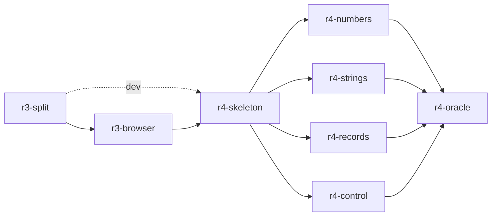

## Context

[docs/wp33-round-trip.md](../../docs/wp33-round-trip.md) is the plan of record. R0, R1, R2 and R5's `exact` half are built; §9 says R3 and R4 are not started. The R3 starting point:

- [runtime/shim.mjs](../../runtime/shim.mjs) is one 933-line module. It imports `node:child_process`, `node:crypto`, `node:fs` and `node:os` at :45-48, and uses `process` at ten sites: :387, :458, :464, :526, :532, :672, :676, :686, :756, :794 and :880.
- `fromBytes` (:356) also needs `Buffer`.
- [runtime/nish.mjs](../../runtime/nish.mjs) installs the prelude's globals from it and registers the loader hook (:275-287).
- [runtime/nish.d.ts](../../runtime/nish.d.ts) is ambient only. Nothing exports `i32` as a type.

The R4 starting point:

- The compiler has no TypeScript output.
- It has everything that output needs, as side tables:
  - spans on every node ([src/nodes.ts](../../src/nodes.ts):428)
  - `program.nodeTypes`, `nodeBuiltins`, `nodeProvenIndex` and `nodeProvenNoOverflow` ([src/program.ts](../../src/program.ts):1466-1572)
  - `enterInstance` for generic instances
- It also has the site lists the portability pass finds ([src/portability.ts](../../src/portability.ts) and its three row files).
- `ModuleUnit` keeps each module's `source.text` after `check()` ([src/compilation.ts](../../src/compilation.ts):238).

The live differential's predecessor was stage0's rewriter. All that is left of it is the frozen `tests/differential/goldens/rewrites.txt`, which imports `runtime/shim.mjs`.

**§1 rule 6 binds every stage.** No `.ll` golden is modified or deleted, and `bench/instructions.json` is not raised. Every stage's verification runs the guard in [Verification](#verification). `--emit-ts` is a separate output path that returns before `compilation.emit()`, so it cannot reach the IR, and the runtime is JavaScript the native build never links.

### Hazards

- **[amritk/nish#742](https://github.com/amritk/nish/pull/742) is open.** It adds 55 lines to `runtime/shim.mjs` and 7 to `runtime/nish.mjs`, for non-blocking spawn, kill, `waitPid`, `availableParallelism` and `totalMemory`. If it lands before `r3-split` merges, `r3-split` merges `main` and sorts the new functions into core or the Node adapter. If `r3-split` lands first, #742's author ports them.
- **The rolling freeze.** `src/` may use only what the seed (the last release, 0.18.0 at the time of writing) compiles. Run `bash scripts/fetch-seed.sh --force` first.
- **The wasi link.** `src/` is linked whole into the wasi module, so a new `src/` file avoids the builtins `refuseOnWasm` refuses. Plain `writeFileSync` and `mkdirSync` are fine.
- **The performance ratchet.** It allows no new NL9007 in `src/`.

## Approach

**The core is one specifier, and the host is chosen once, at the entry.**
- Every emitted module imports only from `nish/runtime`, the core.
- Host-bound names (`readFileSync`, `getenv`, `write`, `exit`, …) are exported by the core too, as thin delegates to an installed host object.
- `entry.ts` imports one adapter (`nish/runtime/node` by default) for its side effect, then calls `main`.
- So the emitted modules are host-independent and bundle for a browser unchanged, and switching host is one line in one file.
- Calling a host-bound name with no host installed throws an error that names the missing adapter.

**The core is split by row.** `runtime/core/{numbers,strings,arrays,result,host}.mjs`, each with a `.d.ts`, are re-exported by `runtime/core.mjs` and `runtime/core.d.ts`. The four R4 row stages then each own their own helper file and run concurrently without a shared runtime file.

**Faithful, including class B.**
- §4.5 requires a class-B program (one that panics) to exit 1 with the native message under its emitted TypeScript.
- §4.2 puts faithfulness first.
- So the R4 rows use one rule: **a check the compiler proved away is written as plain TypeScript, and a check it kept becomes a checking helper.**
  - i32 `+` is `(a + b) | 0` where `nodeProvenNoOverflow` holds (or under `--wrapping`), and `addI32(a, b)` elsewhere.
  - `a[i]` stays `a[i]` where `nodeProvenIndex` holds, and is `idx(a, i)` elsewhere.
- **This deviates from §3.1's row**, which writes `(a + b) | 0` everywhere and calls the overflow case "one defined answer". R4f records the change in §3.1. It is the reason `known-failures.txt`'s overflow and division rows do not carry over to the new list.

**Edits compose bottom-up, not as a flat list.**
- [src/fix.ts](../../src/fix.ts)'s `applyEdits` rejects overlapping and same-start edits.
- Class-C sites nest (`(a + b) * c` rewrites both operators), so `--emit-ts` does not reuse it.
- Instead, a node's emitted text is its source span with each rewritten child's emitted text substituted in. A row hook receives its operands' emitted texts and returns its replacement or nothing.
- Only the outermost rewritten nodes become edits on the module text, so the edits are disjoint by construction.
- `Edit {start, end, text}` ([src/diagnostics.ts](../../src/diagnostics.ts):233) is still the type.

**Standard-library modules are emitted too.**
- §3.5 keeps `nish/<module>` as the package's own specifier. But that resolves to `std/<module>.ts`, which is Nish source with class-C sites of its own (i32 arithmetic), not faithful TypeScript.
- So `--emit-ts` writes each std module the program reaches under `<dir>/nish/<module>.ts` and rewrites the specifier relatively.
- The `nish:` builtin modules (`nish:fs`, `nish:process`, `nish:secret`, `nish:unsafe`) become named imports from the core.

**Two rows are refused, not translated, in this plan.**
- **Signals and `nish:net`** need an `async` rewrite that is not local to its statement (§3.5).
- **FFI modules** need the `--emit-napi` bridge (§4.4).
- `--emit-ts` refuses a program that reaches either, with a registered code and no files written. That is a stated gap, not a class-D row. Each gets its own plan.

**The flag is `--emit-ts <dir>`.**
- wp33 §4 writes `--emit ts -o out/`, but the CLI has no `--emit <kind>` form.
- Its siblings are `--emit-dts <path>`, `--emit-napi <path>` and `--emit-header <path>`.
- R4f records the spelling in §4.

**Bun has no adapter in this plan.**
- [.claude/node.md](../node.md) forbids `bun` anywhere in the repo, CI and docs included. An adapter nothing tests would be an unmeasured claim.
- The core is host-agnostic, so a Bun adapter is a later one-file stage once the owner allows Bun in CI.
- R3b's guide page says Bun is untested.

### Stages, ownership and merge order



Each solid edge is a merge-order edge. Development waits on it too, except the dotted one:
- `r4-skeleton` may start once `r3-split` merges, alongside `r3-browser`, but it merges after `r3-browser`.
- The four row stages develop concurrently and merge one at a time. Each merges `main` and regenerates the generated files before it merges.

| Stage | Owns | Model |
| --- | --- | --- |
| `r3-split` | `runtime/core.mjs`, `runtime/core/*.mjs`, `runtime/node.mjs`, `runtime/shim.mjs`, `runtime/nish.mjs`, `tests/runtime/**`, `tests/run.js` (the new `runtime-hosts` section only), `tests/shard-costs.json`, `docs/RUN_UNDER_NODE.md` | — |
| `r3-browser` | `runtime/browser.mjs`, `runtime/host.d.ts`, `runtime/core.d.ts`, `runtime/core/*.d.ts`, `package.json`, `tests/runtime/**`, `tests/run.js` (the `runtime-hosts` section and the npm-pack `required` list), `docs/RUN_UNDER_NODE.md`, `docs/guide/using-nish/to-typescript.md`, `scalar.config.json` | — |
| `r4-skeleton` | `src/emit-ts.ts`, `src/emit-ts-edits.ts`, `src/emit-ts-{numbers,strings,records,control}.ts` (stubs only), `src/compile.ts`, `src/options.ts`, `src/codes.ts`, `tests/cases/reject_emit_ts_*`, `tests/emit-ts/**`, `tests/differential/emit-ts.js`, `tests/differential/emit-ts-known.txt`, `tests/nish/cli.ts`, `tests/run.js` (the new `emit-ts` section and the `documented` flag list), `tests/wordings/**`, `tests/self/goldens/**`, `docs/guide/using-nish/cli.md`, `docs/LANGUAGE.md`, `.claude/selfhost.md` | — |
| `r4-numbers` | `src/emit-ts-numbers.ts`, `runtime/core/numbers.{mjs,d.ts}`, `tests/emit-ts/numbers/**`, plus the generated files | — |
| `r4-strings` | `src/emit-ts-strings.ts`, `runtime/core/strings.{mjs,d.ts}`, `tests/emit-ts/strings/**`, plus the generated files | — |
| `r4-records` | `src/emit-ts-records.ts`, `runtime/core/arrays.{mjs,d.ts}`, `tests/emit-ts/records/**`, plus the generated files | — |
| `r4-control` | `src/emit-ts-control.ts`, `runtime/core/result.{mjs,d.ts}`, `tests/emit-ts/control/**`, plus the generated files | — |
| `r4-oracle` | `tests/emit-ts/tsconfig.json`, `tests/run.js` (the `emit-ts` section), `tests/differential/emit-ts.js`, `tests/differential/emit-ts-known.txt`, `tests/differential/fuzz.js`, `.github/workflows/ci.yml`, `docs/wp33-round-trip.md`, `docs/MASTER_PLAN.md`, `docs/ARCHITECTURE.md`, `docs/AI.md`, `docs/guide/using-nish/to-typescript.md` | — |

**Generated files** (regenerated with the repo's tooling, never hand-merged):
- `tests/self/goldens/**` (`node tests/self/goldens.js --update`)
- `tests/differential/goldens/**` (`node tests/differential/goldens.js --update`)
- `tests/differential/emit-ts-known.txt` (`node tests/differential/emit-ts.js --update`)
- `tests/emit-ts/**/*.expected.ts` (`node tests/run.js emit-ts` with `UPDATE_GOLDENS=1`)

**Shared files with an edge between their writers:**
- `tests/run.js`: separate sections, but `r3-split`, `r3-browser`, `r4-skeleton` and `r4-oracle` all touch it.
- `tests/runtime/**` (`r3-split`, then `r3-browser`).
- `docs/RUN_UNDER_NODE.md`.
- `docs/guide/using-nish/to-typescript.md` (`r3-browser`, then `r4-oracle`).
- Every concurrent pair is disjoint apart from these and the generated files.

No stage is `Model: sonnet`. Each one designs an interface or a translation.

## R3a — the core and the Node adapter

### The core

| File | From `shim.mjs` |
| --- | --- |
| `runtime/core/numbers.mjs` | `toI32`, `toI64`, `toF64`, `f64ToBits`, `bitsToF64`, `convert`, `ctSelect`, `ctEq`, the i64 and u64 wrap, shift, abs, min and max helpers, `parseInt`, `parseFloat`, `number` (:56-262, :883-915) |
| `runtime/core/strings.mjs` | `strLen`, `charCodeAt`, `substring`, `slice`, `indexOf`, `startsWith`, `endsWith`, `fromCharCode`, `fromBytes` (:286-362) |
| `runtime/core/arrays.mjs` | `idx`, `pop`, `setIdx`, `updIdx`, `arraySet`, `newArray`, the Arena stubs (:468-520, :926-933) |
| `runtime/core/result.mjs` | `Ok`, `Err`, `caught`, the Result class and its propagation sentinel, `Secret`, `secret`, `expose`, `exposeWith`, `wipe`, `secureZero` (:136-169, :390-466, :813) |
| `runtime/core/host.mjs` | the host interface below, and `log`, `error`, `write`, `writeError`, `panic`, `exit`, `getRandomValues` (through `globalThis.crypto`, which Node 22, Bun and browsers all have) |

**`fromBytes` drops `Buffer`.**
- It builds its string from `String.fromCharCode` over chunks of at most 8192 bytes.
- That is exact Latin-1, one code unit per byte, as the native meaning is.
- `TextDecoder("latin1")` is not a substitute: it decodes windows-1252.

`runtime/core.mjs` is `export * from` each of the five files. The shim's top-of-file comment (:1-44) moves with the code it describes.

### The host interface

```js
// runtime/core/host.mjs
/** @typedef {{ writeOut(s: string): void, writeErr(s: string): void, exit(code: number): never,
 *   argv(): string[], call(name: string, args: unknown[]): unknown }} NishHost */
export function installHost(host) { … }
export function readFileSync(path) { return currentHost().call("readFileSync", [path]) }
```

- Every host-bound name in `shim.mjs` (:535-804, :846-876) becomes a delegate of this shape, under the same name and with the same arguments.
- `panic` is `writeErr(message + "\n")` followed by `exit(1)`, with the exact words it has today.
- The default host throws `NishNoHost` with the name it was asked for.
- The delegates for signals and net keep their current loud throw, which needs no host.

### The Node adapter

`runtime/node.mjs` holds today's Node bodies, moved and not rewritten:
- `fs.writeSync` output and `process.exit`
- the fs calls with their `O_NOFOLLOW` flags (:570-572)
- `readdirSync`'s `Buffer.compare` sort (:643)
- `spawnImpl` (:689-742)
- `process.hrtime.bigint`, `process.env`, `process.platform`, `process.arch` and `process.geteuid`
- `argv` from `process.argv.slice(1)`

It calls `installHost` at import, so importing it is enough.

### The prelude and the shim

- `runtime/shim.mjs` becomes `export * from "./core.mjs"` plus `import "./node.mjs"`. Every export name it has today stays exported, because the frozen rewrites (`tests/differential/goldens/rewrites.txt`) import it by those names.
- `runtime/nish.mjs` imports the shim as before. Its globals, its `Array.prototype.set`, its `console` and `crypto.getRandomValues` replacements and its loader hook are unchanged in behaviour.
- `nish:secret` still resolves to the shim.

### Tests

New section `runtime-hosts` in [tests/run.js](../../tests/run.js), with a `tests/shard-costs.json` entry if the sharder needs one. It has two checks:

1. `runtime-hosts: shim.mjs exports every name it exported before the split`. The check compares against `tests/runtime/shim-exports.txt`, the sorted export list taken at the stage's base.
2. `runtime-hosts: the core imports no node: module and names no process or Buffer`. The check is a text scan of `runtime/core.mjs` and `runtime/core/*.mjs`, which follows their `import` lines.

The rest is held by checks that already exist, unmodified:
- the `differential` section (the frozen rewrites through the shim, and `unmodified.js` through the prelude)
- the `os_`, `net_`, `rt4_nofollow`, `str_from_bytes`, `ct_prelude`, `bytes_prelude_bigint` and `nish:secret` prelude checks

A diff that edits one of these to make it pass is a failed stage.

### Docs

[docs/RUN_UNDER_NODE.md](../../docs/RUN_UNDER_NODE.md) says the prelude is now a layer over `runtime/core.mjs` and `runtime/node.mjs`, and keeps its command lines.

Internal change: no guide page and no changelog prose beyond a `refactor(runtime):` subject and body.

## R3b — the browser adapter, the entry points and their types

### The browser adapter

`runtime/browser.mjs` installs a host that:
- **writes** by buffering to the next `\n` and handing each line to `console.log`, or `console.error` for `writeErr`;
- **exits** by throwing `NishExit` with `code`, after flushing (a page cannot end its process);
- **answers** `argv()` with `["main"]`, `getenv` with `null` and `monotonicNanos` with `BigInt(Math.round(performance.now() * 1e6))`;
- **panics** on every file-system, process and stat call, with `<name> is not available in a browser`, through the core's `panic`.

### The entry points

`package.json` `exports` gains three exact keys. They win over the `./runtime/*` and `./*` patterns, and the bare `./runtime` key would otherwise fall to `./*` and resolve to `std/runtime.ts`:

```json
"./runtime": { "types": "./runtime/core.d.ts", "default": "./runtime/core.mjs" },
"./runtime/node": { "types": "./runtime/host.d.ts", "default": "./runtime/node.mjs" },
"./runtime/browser": { "types": "./runtime/host.d.ts", "default": "./runtime/browser.mjs" },
```

`runtime/host.d.ts` declares only that the module installs a host (`export {}`), and belongs to this stage. `files` already ships `runtime/`.

### The declarations

`runtime/core.d.ts` re-exports `runtime/core/*.d.ts`:
- the width types, as `export type i32 = number` and `export type i64 = bigint`, with `u64` as `bigint` and the rest as `number`
- `Result<T, E>`
- every helper's signature

They must agree with [runtime/nish.d.ts](../../runtime/nish.d.ts)'s ambient declarations for the same names. The check below compares the two lists.

### Tests

In the `runtime-hosts` section:

1. `runtime-hosts: the core and the browser adapter run with only web globals`.
   - `tests/runtime/web-context.mjs` runs under `node --experimental-vm-modules`.
   - It creates a `vm` context holding only `console`, `performance`, `crypto`, `TextEncoder`, `TextDecoder`, `queueMicrotask` and `setTimeout`, with no `process`, no `Buffer` and no `require`.
   - It links `core.mjs` and `browser.mjs` as `SourceTextModule`s, with `node:` specifiers refused by the linker.
   - It calls one helper from each core file, plus `write`, `panic` and `exit`.
   - It asserts the lines and the `NishExit` code, and asserts that `readFileSync` panics naming the browser.
2. `runtime-hosts: the package resolves nish/runtime, /node and /browser`. The check uses `import.meta.resolve` through a self-reference from inside the package.
3. `runtime-hosts: core.d.ts declares every name the core exports, and agrees with nish.d.ts`.

The npm-pack `required` list (`tests/run.js` around :17965) gains `runtime/core.mjs`, `runtime/core.d.ts`, `runtime/node.mjs` and `runtime/browser.mjs`.

### Docs

- New guide page `docs/guide/using-nish/to-typescript.md` ("Back to TypeScript"), routed in `scalar.config.json` under `/using-nish`, written to [docs/README.md](../../docs/README.md#writing-a-guide-page)'s page rules. It covers the runtime half:
  - the three entry points and what each host answers
  - that Bun is untested
- `docs/RUN_UNDER_NODE.md` points to it.
- Commit as `feat(runtime):`.

## R4a — the driver, the composer, the differential

### The flag

`--emit-ts <dir>` in [src/compile.ts](../../src/compile.ts)'s flag loop (:482-718):
- It stores the path in `opts.emitTs` ([src/options.ts](../../src/options.ts)) and sets `productFlag`, so `run` and `--fix` refuse it.
- It runs after `check()` and the reports, beside `--emit-checked` (:975-1001). It returns before `compilation.emit()`, which it never calls.
- It turns on the portability pass, which §5.2 asks for. Those warnings print as usual and do not block the output.
- `-o` alongside it is a usage error (exit 2).
- It is added to `helpText` in [src/cli-style.ts](../../src/cli-style.ts), to `advertisedFlags` in [tests/nish/cli.ts](../../tests/nish/cli.ts) (:95-117), and to `documented` in `tests/run.js` (:17244-17266).

### The composer

`src/emit-ts-edits.ts` exports `emitNode(walk, node): string`:
- A row hook's replacement if one fires.
- Otherwise the node's source span with each child that changed replaced by its own emitted text.

It records each module's top-level changed nodes as `Edit`s, applied front to back. A node whose emitted text equals its source contributes no edit, so a class-A module is byte-identical to its source. Generic instances are walked with `enterInstance`. Where two instances of one template node would emit different text, that is a hard error naming the node; the fixtures pin that none exists in the corpus.

### The driver

`src/emit-ts.ts`:
1. **Picks the modules.**
   - Root-package modules (`packageName === ROOT_PACKAGE`, as [src/fix.ts](../../src/fix.ts):140 does) go to `<dir>/` at their path relative to the entry's directory.
   - Reached std modules go to `<dir>/nish/<module>.ts`.
2. **Rewrites the specifiers.**
   - Relative specifiers gain `.ts`, because Node's type stripping needs the extension; Nish sources write `"./locals"`.
   - `nish/<module>` becomes the relative path to the emitted std file.
   - `nish:` modules become `nish/runtime`.
3. **Adds one import line at the top of each changed module.**
   - It names every ambient global the module uses (from `nodeBuiltins` and the ambient table) and every helper a row hook registered through `walk.useHelper(name)`.
   - It adds `import type { i32, … }` for each width type the module spells.
   - If the module begins with a comment, the line goes after it.
4. **Writes `<dir>/entry.ts`.** It imports `nish/runtime/node`, imports `main` from the entry module, and exits with its answer through the core's `exit`.
5. **Writes nothing on refusal.** Files are written only after every module has emitted.

### The row hooks

`src/emit-ts-{numbers,strings,records,control}.ts` each export one `(walk, node, operands) => string | null` that returns `null`. The composer calls all four in a fixed order. Row stages fill their own file and touch nothing else in `src/`.

### Refusals

Take the next free codes in the NL4xxx sidecar band, NL4010 and NL4011 at the time of writing. Check with `node scripts/gen-diagnostic-codes.mjs`.
- **NL4010:** "--emit-ts cannot write a module that declares C functions; keep it native and import it through --emit-napi (wp33 §4.4)".
- **NL4011:** "--emit-ts cannot yet write signalFd, readSignal or nish:net, whose translation is not local to its statement (wp33 §3.5)".

Each gets a `diagnosticRules` entry and a `RULE_COUNT` bump. Each is provoked by `tests/cases/reject_emit_ts_ffi.{ts,args,err}` or `reject_emit_ts_net.{ts,args,err}`, under `--emit-ts`.

### Tests

`tests/emit-ts/<row>/<name>.ts` with `<name>.expected.ts` (the emitted entry module) and `<name>.out`.

The `emit-ts` section of `tests/run.js` discovers the directories, so later stages add fixtures without editing `tests/run.js`. For each fixture it:
1. emits;
2. compares the emitted module with `.expected.ts` (`UPDATE_GOLDENS=1` writes it);
3. runs `node --experimental-strip-types --no-warnings <dir>/entry.ts` (adding `--js-explicit-resource-management` on Node below 24);
4. compares stdout and exit status with `.out` and with the native binary.

This stage's fixtures are `tests/emit-ts/identity/`: three class-A programs (records, `Map`, classes, `for...of`, a comment-heavy file) whose emitted module must be byte-identical to the source. The check is `emit-ts: a class-A module is written byte for byte`.

The PR body shows the emitted TypeScript for every fixture it adds, as CLAUDE.md asks of IR.

### The live differential

`tests/differential/emit-ts.js`:
- It takes the whole programs `tests/differential/run.js` takes (`tests/cases` with a `main` and no `.err`, plus `tests/differential/corpus`).
- For each one, it builds natively and emits with `--emit-ts`, runs both, and compares stdout, stderr and exit status.
- It reads `tests/differential/emit-ts-known.txt`, one `<program> <reason>` line each, where reason is the ledger row (`numbers`, `strings`, `records`, `control`, `libm`, `ffi`, `refused`).
- It fails on an unlisted disagreement and on a listed program that agrees (XPASS).
- `--update` rewrites the list from the run, so a conflict in it is regenerated, never resolved.
- The `emit-ts` section runs it as the check `emit-ts: the corpus under --emit-ts agrees with native (N programs, K known)`.
- At this stage most programs are listed.

### Docs

- `docs/guide/using-nish/cli.md` gains `--emit-ts`, its output layout and the two refusals.
- `docs/LANGUAGE.md`'s flags section gains it.
- `.claude/selfhost.md`'s module map gains the five `emit-ts` files.
- Commit as `feat(cli): write a program back out as TypeScript with --emit-ts`.
- Before pushing:
  - Regenerate `tests/self/goldens` and read the diff.
  - Run `node tests/run.js wasi` (read its skip line) and `node tests/run.js performance`.

## R4b — the number rows

### Integers

| Site (§3.1) | Emitted |
| --- | --- |
| i32 `+ - *`, proven by `nodeProvenNoOverflow` or under `--wrapping` | `(a + b) \| 0`, `(a - b) \| 0`, `Math.imul(a, b)` |
| i32 `+ - *`, unproven | `addI32(a, b)`, `subI32(a, b)`, `mulI32(a, b)`, each panicking with the native overflow message |
| integer `/` and `%` | `idiv(a, b)`, `irem(a, b)`, panicking on zero and on `MIN / -1` as native does |
| `u8` / `u16` / `u32` arithmetic | `& 0xff`, `& 0xffff`, `>>> 0` |
| `i64` / `u64` | literals gain `n`; operations through `BigInt.asIntN(64, …)` / `asUintN`; the types stay spelled `i64`/`u64`, imported as `bigint` |
| i32 `>>> n` | `(a >>> n) \| 0` |

The helpers go in `runtime/core/numbers.mjs` and `.d.ts`. Under `--number-mode f64` `number` is f64 and only the spelled integer types are rewritten.

### Conversions and Math

`toI32` and the other conversions, and `Math.min`, `max` and `round` with their NaN and `-0` rules, go to the core's helpers. The 1-ulp libm row stays `libm` in the known list.

### Tests

Fixtures in `tests/emit-ts/numbers/`:
- one per table row;
- an overflow that panics, with `.out` and exit 1;
- a nested expression that exercises the composer.

Regenerate the known list and confirm that no `numbers` line is left. Commit as `feat(cli):` with the translation table in the body.

## R4c — the string rows

### Offsets

On a receiver typed `string`, the following become `strLen(s)`, `charCodeAt(s, i)`, `indexOf(s, t)`, `slice(s, a, b)` and `substring(s, a, b)` from the core:
- `.length`
- `charCodeAt`
- `indexOf`
- `slice`, which panics outside `[0, length]` as native does
- `substring`

`startsWith` and `endsWith` are prefix tests that agree in either unit, so they stay as written.

### Builders and parsers

- `String.fromBytes(b, s, e)` becomes `fromBytes(b, s, e)`. `String.fromCharCode` becomes `fromCharCode`.
- `parseInt`, `parseFloat` and `Number(s)` become imports from the core. The global is never replaced, as §3.2 asks.

### Tests

Fixtures in `tests/emit-ts/strings/`, each with a non-ASCII literal (`"héllo"`) so a UTF-16 reading would print something else:
- a `slice` past the end that panics;
- `fromBytes([195, 169], 0, 2)`.

The known list keeps no `strings` line.

## R4d — the array and record rows

### Records

Copy-in sites become `{ ...p }`:
- `push(p)`
- `[p, q]`
- `ps[i] = p` into a fresh slot

The sites are the ones `src/portability-records.ts` already finds for NL8003. A store of a record over an element that a reference still reads becomes a field-by-field write into the existing object (`ps[0].x = q.x; ps[0].y = q.y`), the NL8004 sites. Nested record fields are pointers natively, so the shallow spread is exact.

### Arrays

- `new Array<T>(n)` becomes `newArray(n, zero)`, with `0`, `0n` or `false` as the zero for `T`.
- `dst.set(src, at)` becomes `arraySet(dst, src, at)`.
- An index read, an indexed store, a compound store and `pop()` whose bounds `nodeProvenIndex` did not prove become `idx`, `setIdx`, `updIdx` and `pop`. A proven one stays as written.

### Tests

Fixtures in `tests/emit-ts/records/`:
- §3.3's two reproductions, the push-then-write and the reference-then-store;
- an out-of-range index that panics;
- a proven loop whose emitted text keeps `a[i]` (the check `emit-ts: a proven index is written as a plain index`).

The known list keeps no `records` line.

## R4e — control flow, Result and enums

### orReturn

`const v = f().orReturn();` becomes:

```ts
const __t1 = f(); if (__t1.isErr()) return Err(__t1.error); const v = __t1.value;
```

The prelude is inserted before the enclosing statement. The checker already knows the statement and the function's `Result` type. Temporaries are `__t<n>`, numbered per function and checked against the function's locals. Several `orReturn`s in one statement hoist left to right.

### Enums

`enum Color { Red, Green }` becomes:

```ts
const Color = { Red: 0, Green: 1 } as const; type Color = (typeof Color)[keyof typeof Color];
```

The values are the checker's (`nodeEnumValues`). Member reads are unchanged.

### Tests

Fixtures in `tests/emit-ts/control/`:
- an `orReturn` chain;
- an `orReturn` inside a nested expression;
- a string enum and a numeric enum;
- a `using s = scope()` block run through the Node flag.

The known list keeps no `control` line.

## R4f — the oracle closed, and the docs

### Strict TypeScript

`tests/emit-ts/tsconfig.json` sets:
- `strict`
- `noEmit`
- `allowImportingTsExtensions`
- `module` and `moduleResolution` `nodenext`
- `paths` unset, because the package resolves itself

The `emit-ts` section emits the whole differential corpus into one build directory and runs `npx tsc -p` over it. The check is `emit-ts: the emitted corpus type-checks under tsc --strict`.

### The known list

The section fails if `emit-ts-known.txt` holds any reason other than `libm`, `ffi` or `refused`. That pins §4.5's "shrinks to the libm row and the FFI rows".

### Fuzz

`tests/differential/fuzz.js --emit-ts`:
1. generates programs as it does now;
2. builds each natively;
3. emits it with `--emit-ts` and runs it under Node;
4. compares the two.

This restores the comparison the file's header says R6 lost (:48-52). Add a `.github/workflows/ci.yml` step beside the existing fuzz step (:740) running `--emit-ts --seed 20261001 --count 200`.

### Docs

- [docs/wp33-round-trip.md](../../docs/wp33-round-trip.md):
  - the header and §9 say that R3 and R4 are built, with PR numbers;
  - §3.1's overflow row and §3.3's index row state the checked-helper rule;
  - §4's command line reads `--emit-ts <dir>`;
  - §4.3 records Bun as deferred;
  - §3.5's signals and net rows and §4.4 say `--emit-ts` refuses them for now (NL4010, NL4011).
- [docs/MASTER_PLAN.md](../../docs/MASTER_PLAN.md):253 and :414 mark R3 and R4 built.
- [docs/ARCHITECTURE.md](../../docs/ARCHITECTURE.md)'s construct checklist: a class-C construct now ships its `--emit-ts` translation and a fixture in `tests/emit-ts/`, as §6.1 says it must once `--emit ts` exists.
- [docs/AI.md](../../docs/AI.md)'s loop states step 6 with `--emit-ts`.
- The guide page gains the `--emit-ts` half: the command, the layout, the translation table, and the ratchet of §4.2.

## Out of scope

- **A Bun adapter.** Bun cannot run in CI while [.claude/node.md](../node.md) forbids it.
- **The `async` translation of signals and `nish:net`, and the FFI bridge.** Both are refused with NL4010 and NL4011.
- **Lowering `using` to `try`/`finally` for hosts without it.**
- **Deleting the frozen rewrites or `runtime/shim.mjs`.** Both keep working as layers.
- **The `review` fix tier (R5) and compat mode (R6).**
- **Any change to a lowering, an attribute or a layout.**
- **An "idiomatic" mode** (declined, §8).

## Tests

| Stage | New checks (exact names are the stage's to fix; grep them before pushing) |
| --- | --- |
| `r3-split` | `runtime-hosts:` shim export pin, core has no Node reach; every existing prelude and differential check unmodified |
| `r3-browser` | `runtime-hosts:` web-globals-only run, package resolution, declarations agree; the npm-pack list |
| `r4-skeleton` | `emit-ts:` byte-for-byte class A, fixture goldens and runs, the live differential with its known list; `reject_emit_ts_ffi`, `reject_emit_ts_net` |
| row stages | `emit-ts:` fixtures in their directory; their reason gone from the known list |
| `r4-oracle` | `emit-ts:` strict typecheck, the known-list pin; fuzz `--emit-ts` in CI |

## Verification

Every stage, before the PR and after the merge of `main` before it merges:

```bash
bash scripts/fetch-seed.sh --force        # src/ stages
npm run check && npm run lint             # read the exit status, never a piped tail
node tests/run.js runtime-hosts           # R3 stages
node tests/run.js emit-ts                 # R4 stages
node tests/run.js wasi && node tests/run.js performance   # every stage touching src/; read the wasi skip line
node tests/self/goldens.js --update && git diff --stat tests/self/goldens   # src/ stages; read the diff
npm test > build/npm-test.log 2>&1; echo $?   # undegraded: read the skip count and the DEGRADED banner
# §1 rule 6 — must print nothing:
git diff --diff-filter=MDR --name-only origin/main...HEAD -- '*.ll' bench/instructions.json
```

A row stage also runs `node tests/differential/emit-ts.js --update` and commits the regenerated list.

### Run notes for /feature

- **Targeted test command:** `node tests/run.js <section>`.
- **Full suite:** `npm test`, 40–70 minutes. Run it twice per PR, per [CLAUDE.md](../../CLAUDE.md#spending-tokens).
- **No coverage command.** The repository's gate is an undegraded `npm test` plus the golden checks, so Phase 0's coverage precondition needs the owner's waiver to read "the gate is `npm test`".
- **Generated globs** are listed under Stages, ownership and merge order above.

### Acceptance criteria

1. `nish <program> --emit-ts out/` writes one `.ts` per root-package module at its relative path, the reached std modules under `out/nish/`, and `out/entry.ts`. `node out/entry.ts` on Node 22.18 prints what the native binary prints and exits with its status.
2. A module with no class-C site is written byte for byte: `cmp` of source and output succeeds.
3. In `npm test`, every whole program in `tests/cases` and `tests/differential/corpus` agrees with its native binary under `--emit-ts` on stdout, stderr and exit status. That includes the programs that panic. The only exceptions are listed in `tests/differential/emit-ts-known.txt`, whose reasons are only `libm`, `ffi` and `refused`.
4. `tsc --strict --noEmit` over the emitted corpus exits 0.
5. `nish/runtime`, `nish/runtime/node` and `nish/runtime/browser` resolve from the published package. The core and the browser adapter import no `node:` module, and they load and run in a context with only web globals. A file-system call under the browser adapter panics naming the host.
6. Every program that ran under `node --import runtime/nish.mjs` before R3 prints the same output after it. The existing prelude checks and `unmodified.js` pass unmodified.
7. Across every merged PR, no existing `.ll` golden is modified or deleted, `bench/instructions.json` is unchanged, and `node tests/run.js instructions` is green on `main`.
8. `--emit-ts` on a program that declares C functions, or that uses `signalFd` or `nish:net`, exits non-zero with a `--json` diagnostic of a registered NL4xxx code, and writes no file.
9. `node tests/differential/fuzz.js --emit-ts` runs, and CI runs it.
10. `nish --help` lists `--emit-ts`. The guide has a routed "Back to TypeScript" page covering the runtime entry points and `--emit-ts`.
